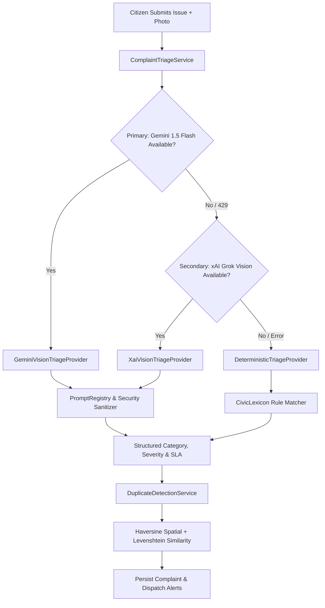
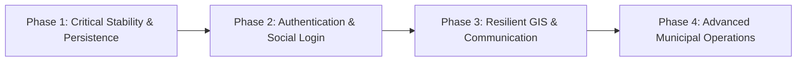

# CIVICFIX PHASE 1: COMPREHENSIVE ARCHITECTURAL & CAPABILITY AUDIT

**Date:** November 23, 2026  
**Auditor:** Senior Java Spring Boot Backend Engineer, DevOps Engineer, Application Security Auditor & QA Engineer  
**Audit Mode:** STRICTLY READ-ONLY (No code modifications, no database changes, no Git commits or remote deployments)  
**Git HEAD:** `eb42857` (synchronized with `origin/main`)  
**Production Backend:** `https://civicfix-backend-wx6m.onrender.com` (Render, Docker, Java 21)  
**Production Frontend:** `https://civicfix-red.vercel.app` (Vercel, React 18, Vite)  
**Production Database:** Neon Serverless PostgreSQL (`sslmode=require`)  

---

## EXECUTIVE SUMMARY

CivicFix is a modern municipal civic issue reporting and resolution platform engineered with a decoupled, enterprise architecture: a React 18 single-page application (SPA) hosted on Vercel and a Java 21 / Spring Boot 3.3.4 RESTful API containerized on Render. The system employs stateful HTTP-only cookie sessions (`CIVICFIX_SESSION`), strict OWASP CSRF token validation (`XSRF-TOKEN`), fine-grained Role-Based Access Control (RBAC) across five distinct tiers, multimodal AI classification (Google Gemini 1.5 Flash and xAI Grok Vision), automated geospatial boundary validation, and dual-provider email notifications (Resend REST API primary with Spring Mail SMTP fallback).

The code quality across both frontend (256 passing Vitest unit/integration tests) and backend (563 passing JUnit 5 tests) is high, with explicit sanitization layers against prompt injection, magic-byte image validation, and tamper-resistant audit logs. 

This audit provides a complete, factual inventory of the current platform across 13 core functional areas, categorizes all environment variables, identifies critical architectural bottlenecks, and outlines a phased upgrade roadmap.

---

## 1. DETAILED AUDIT ACROSS 13 CORE AREAS

### 1.1. Project Architecture and Current Implementation
* **Frontend:** React 18.3.1, Vite 5.4.2, Tailwind CSS 3.4.10, Lucide React icons, Leaflet 1.9.4 for maps, Vitest + React Testing Library for tests. Hosted on Vercel with single-page app rewrite routing configured in `vercel.json`.
* **Backend:** Java 21, Spring Boot 3.3.4, Spring Security, Spring Data JPA / Hibernate 6.5, Flyway 10.10, Jackson 2.17. Packaged into a lightweight Alpine Linux Docker container via a multi-stage Dockerfile with Google Cloud Maven mirror resilience.
* **Database:** Neon Serverless PostgreSQL 16 with SSL enforcement (`sslmode=require`). Schema changes are governed exclusively by 20 forward Flyway migrations (`V1__initial_schema.sql` through `V20__add_resolution_sla_escalation.sql`). Hibernate DDL generation is strictly validated (`hibernate.ddl-auto: validate`), preventing schema drift.
* **Network & Security:** Secure SameSite cookie management (`SameSite=None` in production for cross-origin Vercel-to-Render requests), CSRF Double-Submit Cookie Pattern (`CookieCsrfTokenRepository`), production origin whitelisting (`ProductionSafetyGuard.java`), and rate-limiting filters.

### 1.2. Five-Tier Role-Based Access Control (RBAC)
The platform defines exactly five enum-backed roles in [RoleName.java](file:///c:/Users/harsh/Downloads/stitch_civicfix_ai_platform_design/backend/src/main/java/com/civicfix/model/RoleName.java) mapped to database authority tables:
1. `ROLE_CITIZEN`: Can report issues, track personal submissions, view the public map, comment on complaints, upvote community issues, and manage profile settings.
2. `ROLE_OFFICER`: Departmental level authority. Can triage complaints, assign complaints to specific workers or supervisors, adjust severity/priority, review SLA timelines, and access operational analytics.
3. `ROLE_WORKER`: Field operative. Can accept tasks, update ticket progress to `IN_PROGRESS`, upload before/after photographic proof of resolution, and mark tickets as `RESOLVED`. Cannot alter ticket category or reassign.
4. `ROLE_SUPERVISOR`: Zonal supervisory authority introduced in Flyway migration `V9`. Can oversee cross-departmental escalations, approve/reject resolution evidence submitted by workers, reopen disputed tickets, and monitor SLA breach alerts.
5. `ROLE_ADMIN`: Platform superuser. Full administrative access to system health, user lifecycle management, audit logs, and staff account creation (`/api/admin/**`).

In the frontend, route protection is strictly enforced by [RoleRoute.jsx](file:///c:/Users/harsh/Downloads/stitch_civicfix_ai_platform_design/src/App.jsx) and navigation menus dynamically filter tabs according to the active role in `AuthContext.jsx`.

### 1.3. Registration, Authentication, Password Recovery & Staff Management
* **Citizen Registration:** Open endpoint `POST /api/auth/register`. Only allows creating `ROLE_CITIZEN` accounts. Any attempt to supply an administrative role via payload is ignored or rejected.
* **Authentication:** Handled by [AuthController.java](file:///c:/Users/harsh/Downloads/stitch_civicfix_ai_platform_design/backend/src/main/java/com/civicfix/controller/AuthController.java) via `POST /api/auth/login`. Authenticates against BCrypt-hashed passwords (`BCryptPasswordEncoder` with strength 12). On success, issues an encrypted, HTTP-only session cookie (`CIVICFIX_SESSION`).
* **Session Persistence:** Validated via `GET /api/auth/me`. Graceful fallback on 401 unauthenticated.
* **Logout:** `POST /api/auth/logout` invalidates the Spring Security context and clears the session cookie with `Max-Age=0`.
* **Password Recovery:** Implemented via [PasswordResetToken.java](file:///c:/Users/harsh/Downloads/stitch_civicfix_ai_platform_design/backend/src/main/java/com/civicfix/model/PasswordResetToken.java) (`V11__add_password_reset_tokens.sql`):
  * `POST /api/auth/forgot-password`: Generates a cryptographically secure random token with a 1-hour expiry and dispatches a reset link via email.
  * `POST /api/auth/reset-password`: Validates token hash, checks expiry, updates the BCrypt password, and revokes the token.
* **Staff Account Provisioning:** Non-citizen accounts (`OFFICER`, `WORKER`, `SUPERVISOR`) **cannot register publicly**. They must be provisioned by an authenticated `ADMIN` through [AdminController.java](file:///c:/Users/harsh/Downloads/stitch_civicfix_ai_platform_design/backend/src/main/java/com/civicfix/controller/AdminController.java) (`POST /api/admin/users/staff`). The admin specifies name, email, department, assigned zone, and role. A temporary password or setup invitation is triggered.

### 1.4. Multimodal AI Integrations (Gemini & Grok)
The platform implements a resilient AI vision triage engine under `com.civicfix.ai.vision`:
* **Google Gemini:** [GeminiVisionTriageProvider.java](file:///c:/Users/harsh/Downloads/stitch_civicfix_ai_platform_design/backend/src/main/java/com/civicfix/ai/vision/GeminiVisionTriageProvider.java) invokes the Gemini 1.5 Flash REST endpoint (`generateContent`). It sends base64-encoded image payloads alongside structured system instructions.
* **xAI Grok:** [XaiVisionTriageProvider.java](file:///c:/Users/harsh/Downloads/stitch_civicfix_ai_platform_design/backend/src/main/java/com/civicfix/ai/vision/XaiVisionTriageProvider.java) integrates with xAI's chat completion vision endpoint (`api.x.ai/v1/chat/completions`) using Grok Vision models as an alternate or fallback triage provider.
* **Deterministic Fallback:** [DeterministicTriageProvider.java](file:///c:/Users/harsh/Downloads/stitch_civicfix_ai_platform_design/backend/src/main/java/com/civicfix/ai/vision/DeterministicTriageProvider.java) acts as an offline, rule-based keyword classifier using [CivicLexicon.java](file:///c:/Users/harsh/Downloads/stitch_civicfix_ai_platform_design/backend/src/main/java/com/civicfix/ai/vision/CivicLexicon.java). If both Gemini and Grok fail or credentials are unset, triage falls back seamlessly without breaking complaint creation.
* **Security & Prompt Governance:** Centralized in [PromptRegistry.java](file:///c:/Users/harsh/Downloads/stitch_civicfix_ai_platform_design/backend/src/main/java/com/civicfix/ai/vision/PromptRegistry.java) with explicit sanitization guards against user prompt injection, XML tags delimiters, and structured JSON schema enforcement.

### 1.5. Email Services: Resend API & SMTP
* **Primary Service:** [ResendEmailService.java](file:///c:/Users/harsh/Downloads/stitch_civicfix_ai_platform_design/backend/src/main/java/com/civicfix/service/impl/ResendEmailService.java) marked with `@Primary`. Directly calls Resend's HTTPS REST API (`https://api.resend.com/emails`) using Spring's `RestClient` / `RestTemplate`.
* **Fallback Service:** [DefaultEmailService.java](file:///c:/Users/harsh/Downloads/stitch_civicfix_ai_platform_design/backend/src/main/java/com/civicfix/service/impl/DefaultEmailService.java) implements standard Spring `JavaMailSender` SMTP transport.
* **Templates & Privacy:** HTML/text templates for registration verification, password reset, and complaint status transition notifications. Both services strictly enforce PII masking in server logs (`c***n@domain.com`).

### 1.6. Firebase & Google Sign-In Status
* **Status:** **COMPLETELY UNINTEGRATED / ABSENT**.
* **Evidence:** Thorough scan of `pom.xml`, `package.json`, Spring Security configuration (`SecurityConfig.java`), and frontend components confirms zero references to Firebase SDK, Firebase Auth, Google Identity Services, or Spring Security OAuth2 Client (`spring-boot-starter-oauth2-client` is not in POM). All authentication relies purely on local database credentials and server-side sessions.

### 1.7. Neon Database Schema, Migrations & Existing Records
* **Database Engine:** PostgreSQL 16 (hosted on Neon Serverless).
* **Flyway Migrations (20 Versions):**
  * `V1`–`V2`: Initial schema (users, roles, user_roles, complaints, comments, audit_logs).
  * `V3`–`V5`: AI triage metadata, confidence scores, duplicate tracking link tables.
  * `V6`–`V8`: Departmental mappings, in-app notifications table, SLA tracking columns.
  * `V9`–`V12`: Supervisor role, password reset tokens, geospatial coordinates indexing.
  * `V13`–`V16`: Citizen upvotes, worker assignment logs, resolution proof metadata.
  * `V17`–`V20`: Multilingual notification preferences, SLA escalation queues, resolution feedback ratings.
* **Data Integrity:** Strict foreign key constraints with indexes on foreign keys, geospatial coordinates (`latitude`, `longitude`), and status enum columns.

### 1.8. GIS Map, Geolocation & Nearby Complaint Discovery
* **Backend:** [GisController.java](file:///c:/Users/harsh/Downloads/stitch_civicfix_ai_platform_design/backend/src/main/java/com/civicfix/controller/GisController.java) provides:
  * `/api/gis/reverse-geocode`: Integrates with OpenStreetMap Nominatim with built-in caching and User-Agent compliance.
  * `/api/gis/boundaries/state` & `/api/gis/boundaries/zones`: Returns GeoJSON polygons for Tamil Nadu administrative districts and urban municipal zones.
  * `/api/gis/validate-location`: Validates if coordinates fall within authorized municipal service zones.
* **Public Map K-Anonymity Privacy:** In [ComplaintController.java](file:///c:/Users/harsh/Downloads/stitch_civicfix_ai_platform_design/backend/src/main/java/com/civicfix/controller/ComplaintController.java) (`GET /api/complaints/public/map`), complaint coordinates are randomized/jittered within a small radius or truncated to protect citizen home privacy.
* **Frontend:** Interactive Leaflet map in `ComplaintMap.jsx` and `NearbyComplaints.jsx` displaying categorized cluster markers, radius-based spatial queries, and status-colored pins.

### 1.9. Photo Uploads and Camera Functionality
* **Frontend:** [ImageUploadManager.jsx](file:///c:/Users/harsh/Downloads/stitch_civicfix_ai_platform_design/src/components/ImageUploadManager.jsx) provides live camera feed capture using `navigator.mediaDevices.getUserMedia`, camera selection (environment vs user), file picker fallback, client-side canvas image compression, and thumbnail preview.
* **Backend:** [LocalStorageService.java](file:///c:/Users/harsh/Downloads/stitch_civicfix_ai_platform_design/backend/src/main/java/com/civicfix/service/impl/LocalStorageService.java) manages uploads. Validates magic bytes (JPEG, PNG, WEBP), enforces a strict 10MB file limit, sanitizes filenames with UUID prefixes, and blocks path traversal attempts.

### 1.10. Complaint Assignment, Status Tracking & Notifications
* **Lifecycle:** 11 discrete stages defined in [ComplaintStatus.java](file:///c:/Users/harsh/Downloads/stitch_civicfix_ai_platform_design/backend/src/main/java/com/civicfix/model/ComplaintStatus.java): `SUBMITTED`, `AI_TRIAGED`, `OFFICER_REVIEW`, `ASSIGNED`, `IN_PROGRESS`, `PENDING_APPROVAL`, `RESOLVED`, `REOPENED`, `ESCALATED`, `REJECTED`, `CLOSED`.
* **State Machine:** Governed by [ComplaintService.java](file:///c:/Users/harsh/Downloads/stitch_civicfix_ai_platform_design/backend/src/main/java/com/civicfix/service/impl/ComplaintServiceImpl.java) with strict transition authorization (e.g., workers can only move tickets from `ASSIGNED` -> `IN_PROGRESS` -> `PENDING_APPROVAL`/`RESOLVED`).
* **Notifications:** Every status transition triggers [NotificationService.java](file:///c:/Users/harsh/Downloads/stitch_civicfix_ai_platform_design/backend/src/main/java/com/civicfix/service/impl/NotificationServiceImpl.java), persisting an in-app notification in the `notifications` table and dispatching an asynchronous email to the complaint owner.

### 1.11. AI Classification, Priority Assessment & Duplicate Detection
* **Triage Orchestration:** Upon submission with evidence photos, [ComplaintTriageService.java](file:///c:/Users/harsh/Downloads/stitch_civicfix_ai_platform_design/backend/src/main/java/com/civicfix/service/impl/ComplaintTriageServiceImpl.java) executes vision analysis:
  * Categorizes into municipal domains (Roads, Sanitation, Electricity, Water Supply, Drainage).
  * Evaluates severity (`LOW`, `MEDIUM`, `HIGH`, `EMERGENCY`) based on public safety hazards.
  * Estimates SLA target completion window.
* **Duplicate Detection:** [DuplicateDetectionService.java](file:///c:/Users/harsh/Downloads/stitch_civicfix_ai_platform_design/backend/src/main/java/com/civicfix/service/impl/DuplicateDetectionService.java) performs a hybrid check combining:
  1. Spatial proximity via Haversine great-circle formula (< 50 meters).
  2. Temporal window (active within past 30 days).
  3. Text similarity via Levenshtein / Token-sort ratio on title and description.
  4. Same category match. If a probable duplicate is detected, it links to the parent ticket and prompts the citizen to upvote rather than create clutter.

### 1.12. Dashboard Analytics & Tamil/English Localization
* **Operational Analytics:** [OfficerAnalyticsController.java](file:///c:/Users/harsh/Downloads/stitch_civicfix_ai_platform_design/backend/src/main/java/com/civicfix/controller/OfficerAnalyticsController.java) exposes KPI endpoints for SLA compliance rate, resolution velocity, departmental breakdown, and overdue tickets.
* **Bilingual Localization:** Fully localized in English (`en`) and Tamil (`ta`). Governed by [LanguageContext.jsx](file:///c:/Users/harsh/Downloads/stitch_civicfix_ai_platform_design/src/context/LanguageContext.jsx) with 100% key parity (713 symmetric translation keys) between `src/locales/en.json` and `src/locales/ta.json`. Tamil script rendering verified across all dashboards and complaint submission flows.

### 1.13. Automated Tests, Security & Production Configuration
* **Backend Automated Tests:** 563 unit and integration tests passing (`mvn test`). Includes full coverage of security filters, CSRF repository, password reset tokens, vision fallback, and RBAC endpoints.
* **Frontend Automated Tests:** 256 Vitest unit/component tests passing (`npm run test:run`).
* **Security Guard:** [ProductionSafetyGuard.java](file:///c:/Users/harsh/Downloads/stitch_civicfix_ai_platform_design/backend/src/main/java/com/civicfix/config/ProductionSafetyGuard.java) validates database URL schemes, blocks non-SSL database connections in production, verifies secret key lengths, and prevents startup if test profile active in production.

---

## 2. STATUS CLASSIFICATION OF PLATFORM CAPABILITIES

### 2.1. Fully Implemented Features
1. Five distinct RBAC roles (`CITIZEN`, `OFFICER`, `WORKER`, `SUPERVISOR`, `ADMIN`) with backend authorization annotations (`@PreAuthorize`) and frontend route guards (`RoleRoute.jsx`).
2. Dual-provider AI vision triage pipeline (Google Gemini 1.5 Flash + xAI Grok Vision) with deterministic heuristic fallback (`CivicLexicon.java`).
3. Secure stateful authentication with HTTP-only cookies (`CIVICFIX_SESSION`), SameSite=None handling, and OWASP double-submit CSRF protection (`XSRF-TOKEN`).
4. Password reset workflow via cryptographically secure time-bounded tokens and email delivery.
5. In-app notifications table with read/unread tracking and real-time frontend notification bell.
6. Haversine + Levenshtein duplicate complaint detection and citizen upvoting mechanism.
7. OpenStreetMap Nominatim reverse geocoding with in-memory caching and Tamil Nadu GeoJSON boundary enforcement.
8. 100% symmetric English and Tamil UI localization across 713 keys.
9. 11-stage municipal complaint state machine with role-restricted transitions.
10. Comprehensive test suites (563 backend + 256 frontend passing tests).

### 2.2. Partially Implemented Features
1. **Evidence Photo Storage:** Implemented using `LocalStorageService` which writes to `/app/uploads/evidence`. While file validation and MIME checking are production-grade, the underlying storage relies on the local disk. On Render's ephemeral container filesystem, uploaded images are wiped whenever the container restarts or re-deploys.
2. **Resend Email Delivery:** Resend REST client is fully implemented, but configured to use `onboarding@resend.dev` as the default sender. On Resend free tier accounts, `onboarding@resend.dev` can only deliver emails to the single email address associated with the account owner. Delivering verification or reset emails to arbitrary citizen addresses fails unless a custom verified domain (e.g. `mail.civicfix.org`) is registered and configured.
3. **Staff Account Onboarding:** Admin can create staff accounts via API (`POST /api/admin/users/staff`), but there is no self-service password activation flow where staff receive an invite link with a one-time setup token; admin must manually supply the initial temporary password.
4. **Geocoding Rate Limits:** Reverse geocoding directly targets the public OpenStreetMap Nominatim endpoint (`nominatim.openstreetmap.org`). Under heavy production traffic, this endpoint will enforce HTTP 429 rate limits or IP bans without an enterprise proxy or commercial API key (e.g., Google Maps Geocoding or LocationIQ).

### 2.3. Missing Features
1. **Firebase Integration:** Completely missing. No Firebase Admin SDK in backend and no Firebase client libraries in frontend.
2. **Google OAuth2 / Social Sign-In:** No Google OAuth2 login flow or `spring-boot-starter-oauth2-client` dependency. Citizens can only register with standard email/password.
3. **Cloud Object Storage (S3 / Cloudflare R2 / GCS):** No cloud storage adapter implemented in `StorageService`. Necessary for persistent photo storage across Render container lifecycles.
4. **Push Notifications (Web Push / FCM):** Web push notifications (Service Worker Push API) are absent; notifications are currently polled via in-app REST API or sent via email.
5. **Citizen SMS Notifications:** No Twilio or Indian DLT-compliant SMS gateway integration for mobile notifications.

---

## 3. BUGS AND ARCHITECTURAL RISKS

1. **Ephemeral Local Storage Data Loss (Critical Severity):**  
   * *Risk:* `LocalStorageService` writes user-uploaded photos to `/app/uploads/evidence` inside the Render container. Render containers use ephemeral filesystems. Any redeployment, crash, or container migration completely deletes all user evidence photos, leaving orphaned URLs in PostgreSQL.  
   * *Mitigation:* Implement an S3-compatible cloud storage adapter (`S3StorageService`) targeting Cloudflare R2, AWS S3, or Supabase Storage.
2. **Resend Sandbox Domain Block (High Severity):**  
   * *Risk:* Using `onboarding@resend.dev` limits delivery to the account creator's personal email. Live citizen signups or password resets to external addresses fail silently or trigger Resend API 403 errors.  
   * *Mitigation:* Connect a verified domain in Resend and update `RESEND_FROM_EMAIL` (e.g., `notifications@civicfix.org`).
3. **Render Free-Tier Cold Starts (Medium Severity):**  
   * *Risk:* On Render free tier, web services spin down after 15 minutes of inactivity. The initial wake-up of a Java 21 Spring Boot container takes 45–75 seconds, causing frontend API timeouts or sluggish initial user experience.  
   * *Mitigation:* Configure a lightweight uptime pinger (e.g. Cron or Better Uptime) targeting `GET /api/public/health` every 10 minutes, or upgrade to a Render Starter instance.
4. **Public Nominatim Geocoding Dependency (Medium Severity):**  
   * *Risk:* Nominatim's usage policy strictly prohibits high-frequency commercial requests and enforces a 1 request/second throttling limit. Rapid map panning or bulk citizen reporting could lead to IP blacklisting.  
   * *Mitigation:* Introduce a Redis/PostgreSQL persistent geocoding cache table and provide a commercial fallback provider.
5. **Frontend Demo Role Switcher Exposure (Low Severity):**  
   * *Risk:* The frontend includes a `DevRoleSwitcher` component designed for rapid demoing. While the backend strictly enforces session-based RBAC, having the demo switcher visible in production could confuse real citizens or staff.  
   * *Mitigation:* Ensure `DevRoleSwitcher` is strictly conditionally rendered only when `import.meta.env.DEV` is true.

---

## 4. ARTIFICIAL INTELLIGENCE USAGE ANALYSIS

CivicFix features an advanced, multi-tiered AI architecture designed to prevent vendor lock-in and maintain operational continuity during outages:

### 4.1. Vision Model Implementations
* **Gemini 1.5 Flash:** Default primary vision provider (`GeminiVisionTriageProvider.java`). Directly called via REST API with inline base64 image encoding. Extracts issue classification, hazard assessment, and suggested municipal department.
* **xAI Grok Vision:** Secondary vision provider (`XaiVisionTriageProvider.java`). Provides high-accuracy visual reasoning using xAI's API endpoint.
* **Deterministic Fallback:** Implemented via `CivicLexicon.java` containing over 200 categorized municipal keywords in both English and Tamil. Ensures that even during zero-connectivity or API quota exhaustion, tickets are systematically categorized.

### 4.2. Security & Anti-Jailbreak Architecture
* **Prompt Isolation:** User input is never concatenated directly into system instructions. Instead, [PromptRegistry.java](file:///c:/Users/harsh/Downloads/stitch_civicfix_ai_platform_design/backend/src/main/java/com/civicfix/ai/vision/PromptRegistry.java) isolates citizen descriptions inside strict XML data boundaries (`<user_description>...</user_description>`).
* **System Directives:** Explicit system prompts instruct the vision model to ignore any instructions inside the image or citizen description attempting to override system behavior (anti-jailbreak).
* **Schema Validation:** Model responses must conform to a strict JSON schema (`{category, severity, confidence, reasoning}`). Free-form text outputs are rejected and re-parsed.

---

## 5. STAFF ACCOUNT & LOGIN MECHANISM

A common source of confusion in municipal platforms is how staff members obtain accounts. CivicFix implements an intentional, security-first administrative hierarchy:

1. **Self-Registration Restrictions:**  
   The public registration endpoint `POST /api/auth/register` is hardcoded to assign `ROLE_CITIZEN`. There is no mechanism in the public UI or API for an external user to create an Officer, Worker, Supervisor, or Admin account.
2. **Administrative Provisioning (`AdminController`):**  
   All departmental staff accounts are provisioned exclusively by a system administrator logged in with `ROLE_ADMIN` via `POST /api/admin/users/staff`:
   * Admin enters staff member's Full Name, Official Email, Phone, Department (e.g. Public Works, Sanitation, Electrical), Municipal Zone, and assigned Role (`OFFICER`, `WORKER`, `SUPERVISOR`).
   * The backend generates the user record, assigns foreign key associations to municipal departments, and hashes a temporary password.
3. **Staff Authentication:**  
   Staff log in via the standard login modal/page (`POST /api/auth/login`). Upon successful session generation, the frontend `AuthContext` inspects the user's role authorities and automatically redirects them to their specialized dashboard:
   * `ROLE_OFFICER` -> `/officer` (Triage queue, assignments, analytics)
   * `ROLE_WORKER` -> `/worker` (Assigned tickets, in-progress tasks, photo proof uploads)
   * `ROLE_SUPERVISOR` -> `/supervisor` (Zonal overview, SLA breach escalation, resolution approvals)
   * `ROLE_ADMIN` -> `/admin` (System health, staff provisioning, audit trail)

---

## 6. ENVIRONMENT VARIABLES AUDIT

All environment variables across backend configurations (`application.yml`, `application-prod.yml`, `VisionTriageProperties.java`) and frontend build definitions (`.env`, `apiClient.js`) have been audited and organized into three comprehensive lists.

### 6.1. List 1: Existing Environment Variables Currently Supported

| Variable Name | Component | Required / Optional | Default Value (if unset) | Description |
| :--- | :--- | :--- | :--- | :--- |
| `SPRING_PROFILES_ACTIVE` | Backend | Required in Prod | `dev` | Sets active profile (`prod` for Render). |
| `DATABASE_URL` | Backend | Required | None (JDBC URL) | Neon PostgreSQL connection string. |
| `SPRING_DATASOURCE_URL` | Backend | Required | Alias for `DATABASE_URL` | Fallback JDBC URL property. |
| `SPRING_DATASOURCE_USERNAME` | Backend | Required | Embedded in URL or `civicfix` | Database username. |
| `SPRING_DATASOURCE_PASSWORD` | Backend | Required | Embedded in URL | Database password. |
| `SERVER_PORT` | Backend | Optional | `8080` | Container listening port (Render sets automatically). |
| `APP_CORS_ALLOWED_ORIGINS` | Backend | Required in Prod | `https://civicfix-red.vercel.app` | Comma-delimited list of allowed CORS origins. |
| `APP_SECURITY_SESSION_COOKIE_NAME` | Backend | Optional | `CIVICFIX_SESSION` | Name of the stateful HTTP-only session cookie. |
| `APP_SECURITY_COOKIE_SECURE` | Backend | Optional | `true` in prod | Sets `Secure` flag on cookies. |
| `APP_SECURITY_COOKIE_SAME_SITE` | Backend | Optional | `None` in prod | Sets `SameSite` policy for cross-site Vercel requests. |
| `RESEND_API_KEY` | Backend | Required for Email | None | Resend REST API authorization bearer token. |
| `RESEND_FROM_EMAIL` | Backend | Optional | `onboarding@resend.dev` | Verified sender address for transactional emails. |
| `SPRING_MAIL_HOST` | Backend | Optional | `smtp.gmail.com` | SMTP host for fallback email delivery. |
| `SPRING_MAIL_PORT` | Backend | Optional | `587` | SMTP port. |
| `SPRING_MAIL_USERNAME` | Backend | Optional | None | SMTP username. |
| `SPRING_MAIL_PASSWORD` | Backend | Optional | None | SMTP application password. |
| `CIVICFIX_AI_VISION_ENABLED` | Backend | Optional | `true` | Master toggle for AI multimodal triage. |
| `CIVICFIX_AI_VISION_PRIMARY_PROVIDER` | Backend | Optional | `gemini` | Primary vision provider (`gemini` or `xai`). |
| `GEMINI_API_KEY` | Backend | Optional | None | Google Cloud / AI Studio API key for Gemini 1.5. |
| `GEMINI_MODEL` | Backend | Optional | `gemini-1.5-flash` | Gemini model identifier. |
| `XAI_API_KEY` | Backend | Optional | None | xAI API key for Grok Vision models. |
| `XAI_MODEL` | Backend | Optional | `grok-vision-beta` | xAI Grok vision model identifier. |
| `APP_STORAGE_LOCAL_UPLOAD_DIR` | Backend | Optional | `/app/uploads` | Path for temporary/local image uploads. |
| `VITE_API_BASE_URL` | Frontend | Required | `/api` | Base URL for backend API calls. |
| `VITE_APP_ENV` | Frontend | Optional | `production` | Build environment marker. |

### 6.2. List 2: Missing Variables Required for Planned Features

| Variable Name | Component | Planned Feature | Description |
| :--- | :--- | :--- | :--- |
| `AWS_S3_BUCKET_NAME` / `R2_BUCKET_NAME` | Backend | Cloud Object Storage | Bucket name for persistent evidence photo storage. |
| `AWS_S3_REGION` / `R2_REGION` | Backend | Cloud Object Storage | Datacenter region (e.g. `auto` for Cloudflare R2, `us-east-1`). |
| `AWS_S3_ACCESS_KEY` / `R2_ACCESS_KEY_ID` | Backend | Cloud Object Storage | Access key ID for S3/R2 client authentication. |
| `AWS_S3_SECRET_KEY` / `R2_SECRET_ACCESS_KEY` | Backend | Cloud Object Storage | Secret access key for S3/R2 client authentication. |
| `AWS_S3_ENDPOINT` / `R2_ENDPOINT` | Backend | Cloud Object Storage | Custom endpoint URL (required for Cloudflare R2/MinIO). |
| `AWS_S3_PUBLIC_URL_PREFIX` | Backend | Cloud Object Storage | Public CDN / bucket URL prefix for serving images. |
| `GOOGLE_CLIENT_ID` | Frontend & Backend | Google OAuth2 Sign-In | OAuth 2.0 Web Client ID registered in Google Cloud Console. |
| `GOOGLE_CLIENT_SECRET` | Backend | Google OAuth2 Sign-In | OAuth 2.0 Client Secret for backend code exchange. |
| `VITE_FIREBASE_API_KEY` | Frontend | Firebase Integration | Firebase Web Client API key. |
| `VITE_FIREBASE_AUTH_DOMAIN` | Frontend | Firebase Integration | Firebase Auth domain (e.g. `civicfix.firebaseapp.com`). |
| `VITE_FIREBASE_PROJECT_ID` | Frontend | Firebase Integration | Firebase Project ID for cloud sync/auth. |
| `NOMINATIM_API_KEY` / `LOCATIONIQ_API_KEY` | Backend | Commercial Geocoding | Commercial geocoding key to eliminate OSM rate limits. |

### 6.3. List 3: Optional Variables for Future Integrations

| Variable Name | Component | Future Capability | Description |
| :--- | :--- | :--- | :--- |
| `VAPID_PUBLIC_KEY` | Frontend & Backend | Web Push Notifications | RFC 8292 Application Server Public Key for Web Push. |
| `VAPID_PRIVATE_KEY` | Backend | Web Push Notifications | RFC 8292 Application Server Private Key for Web Push. |
| `VAPID_SUBJECT` | Backend | Web Push Notifications | Mailto or URL contact info for VAPID push payload. |
| `TWILIO_ACCOUNT_SID` | Backend | Citizen SMS Alerts | Twilio Account SID for transactional SMS notifications. |
| `TWILIO_AUTH_TOKEN` | Backend | Citizen SMS Alerts | Twilio Auth Token for SMS API access. |
| `TWILIO_PHONE_NUMBER` | Backend | Citizen SMS Alerts | Twilio registered phone number/sender ID. |
| `SPRING_DATA_REDIS_URL` | Backend | Distributed Cache & Sessions | Redis connection string for multi-instance session clustering. |
| `SENTRY_DSN` | Frontend & Backend | Error Monitoring | Sentry DSN for distributed crash and error telemetry. |
| `CIVICFIX_RATE_LIMIT_PER_MINUTE` | Backend | Dynamic Rate Limiting | Configurable requests-per-minute threshold per IP. |

---

## 7. RECOMMENDED UPGRADE ORDER (PRIORITIZED ROADMAP)

Based on the findings of this audit, the recommended upgrade path is divided into four disciplined phases:

### Phase 1: Critical Storage Persistence & Email Domain Verification (Immediate)
* **Goal:** Eliminate data loss risk and unblock citizen communication.
1. **Implement Cloud Object Storage (Cloudflare R2 or AWS S3):**
   * Create `S3StorageService.java` implementing the existing `StorageService` interface.
   * Configure environment variables for R2/S3 access.
   * Migrate existing local photos to the cloud bucket so images persist indefinitely across Render container redeployments.
2. **Verify Custom Domain in Resend:**
   * Configure DNS records (SPF, DKIM, DMARC) for a custom domain (e.g. `civicfix.org`).
   * Update `RESEND_FROM_EMAIL=notifications@civicfix.org` so transactional emails can be delivered to any citizen email address.

### Phase 2: Authentication Modernization & Staff Onboarding (Short-Term)
* **Goal:** Increase user adoption and streamline staff account management.
1. **Google OAuth2 & Social Sign-In Integration:**
   * Add `spring-boot-starter-oauth2-client` to backend `pom.xml`.
   * Add Google Sign-In button on frontend using Google Identity Services.
   * Auto-provision citizen accounts upon verified Google ID token verification.
2. **Staff Invitation & One-Time Password Reset Flow:**
   * Update `AdminController.java` to generate a one-time activation token upon staff creation.
   * Send an automated email invitation to the new officer/worker with a secure link to set their own permanent password.

### Phase 3: Geospatial Caching & Citizen Notification Channels (Medium-Term)
* **Goal:** Enhance performance and reach citizens on their preferred communication channels.
1. **Geospatial & Geocoding Caching Layer:**
   * Create a database table `geocoding_cache` to store reverse geocoded coordinates.
   * Check cache before dispatching requests to OpenStreetMap Nominatim, preventing HTTP 429 throttling.
2. **Web Push & PWA Notifications:**
   * Implement Web Push API with VAPID keys for browser push notifications when a citizen's complaint changes status.
   * Add PWA service worker manifest for mobile home-screen installation.

### Phase 4: Real-Time WebSockets & Supervisor Analytics (Long-Term)
* **Goal:** Real-time field coordination and advanced executive reporting.
1. **WebSocket / SSE Live Updates:**
   * Introduce Spring WebSocket (`STOMP`) or Server-Sent Events (SSE) so Officers and Workers see live ticket assignments without manual page refreshes.
2. **Advanced Executive Reporting:**
   * Export municipal SLA reports to PDF/Excel for municipal corporation council reviews.

---

## 8. CONCLUSION

CivicFix possesses a mature, highly test-covered, and secure foundation. Its security posture regarding CSRF, session isolation, RBAC enforcement, and AI prompt injection defense is well-engineered. The immediate operational priority is resolving the ephemeral storage constraint by introducing S3/Cloudflare R2 storage and configuring a verified sender domain in Resend. Once these infrastructure improvements are in place, social login and automated staff onboarding can proceed smoothly.
