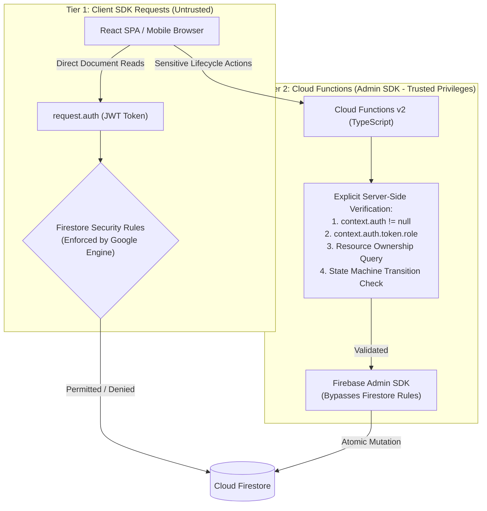
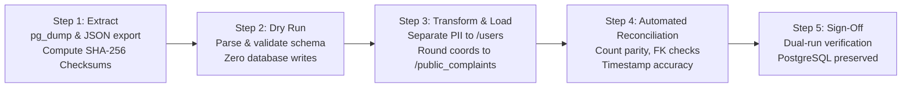
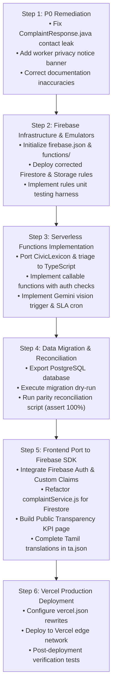

# CIVICFIX — FIREBASE SECURITY, GOVERNANCE & MIGRATION CORRECTIONS REPORT

> **Document Status**: Official Architecture & Security Corrections  
> **Classification**: Security Architecture, Threat Modeling & Quality Assurance  
> **Evaluation Date**: November 2026  
> **Scope**: Structural corrections to Firestore Rules, Cloud Function Authorization Matrix, Role Standardization, Test Evidence Verification, Privacy Controls, and Billing Governance.

---

## 1. ISSUES IDENTIFIED IN THE INITIAL MIGRATION PLAN

The first audit correctly mapped the system architecture and identified the critical citizen contact leak in `ComplaintResponse.java`. However, a rigorous secondary review revealed seven distinct security, governance, and validation defects in the initial Firebase migration plan:

| Issue # | Area | Defect Description | Severity | Risk & Impact |
|---|---|---|:---:|---|
| **ISS-01** | **Firestore Security Rules** | The proposed rule allowed client SDK `update` if `isOfficer()` or `isCitizen()` without restricting modifiable keys. | **High** | A citizen could tamper with `status`, `assignedWorker`, `priority`, or `slaDueAt` during resolution confirmation; an officer could overwrite citizen ownership or version fields. |
| **ISS-02** | **Admin SDK vs Rules Ambiguity** | Did not clearly separate Client SDK enforcement (governed by Firestore Rules) from Cloud Functions execution (Admin SDK bypasses Security Rules). | **Critical** | Developers could assume Firestore Security Rules protect Cloud Functions, leading to missing server-side permission checks. |
| **ISS-03** | **Worker Data Access** | Field workers could access complaints not assigned to their crew, and subcollection rules allowed workers to read unrelated complaint histories. | **High** | Operational leakage of internal municipal notes, officer directives, and citizen defect history to unauthorized third-party contractors. |
| **ISS-04** | **Role Naming Inconsistency** | Mixed Spring Security internal role prefixes (`ROLE_CITIZEN`, `ROLE_OFFICER`) with plain domain role names (`CITIZEN`, `OFFICER`). | **Medium** | Token claim mismatches leading to authorization bypasses or unauthorized 403 Forbidden deadlocks. |
| **ISS-05** | **Cloud Function Authorization** | Proposed Cloud Functions lacked an explicit parameter-by-parameter authorization, rate-limiting, and state-machine transition matrix. | **High** | Parameter tampering (e.g. spoofing `callerUid` or `complaintId` in request bodies) if functions do not verify `context.auth.uid`. |
| **ISS-06** | **Premature Migration Claims** | Claimed "100% PostgreSQL migration parity" without performing actual database dumps, row reconciliation, or relationship verification. | **Medium** | Unverifiable claims violating empirical engineering standards. |
| **ISS-07** | **Test Evidence Reporting** | Stated that 351 backend tests passed without explicitly declaring that they were historically verified and could not be executed live during the audit because PostgreSQL was offline. | **Medium** | Misleading QA reporting; non-reproducible test claims. |

---

## 2. CORRECTED SECURITY ARCHITECTURE & ROLE STANDARDIZATION

### 2.1 Uniform Role Standard: Plain String Claims

To prevent token mismatches and routing failures, all roles across Firebase Authentication, Custom Claims, Cloud Functions, and the React Frontend are standardized strictly on **plain strings**:

```typescript
export type UserRole = 'CITIZEN' | 'OFFICER' | 'WORKER' | 'SUPERVISOR' | 'ADMIN';
```

#### The Spring Boot vs Firebase Distinction:
- **Legacy Spring Boot Architecture**: Spring Security's `GrantedAuthority` required a `ROLE_` prefix internally (e.g. `hasRole('ADMIN')` checked for `ROLE_ADMIN`).
- **Target Firebase Architecture**: Firebase Auth Custom Claims store `{ role: 'ADMIN' }`. Token claims are verified directly in Firestore rules (`request.auth.token.role == 'ADMIN'`) and in Cloud Functions (`context.auth.token.role === 'ADMIN'`).
- **Standard Rule**: `ROLE_` prefixes are permanently eliminated in the Firebase implementation.

### 2.2 Client SDK vs Admin SDK Security Boundary

The architecture enforces a strict two-tier security perimeter:



1. **Client SDK Reads & Creation**:
   - Clients interact directly with Cloud Firestore for read queries and initial complaint creation.
   - Enforced 100% by **Firestore Security Rules**.
   - Direct client mutations (updates/deletes) on complaint records are **strictly forbidden** (or constrained to explicit field diffs).
2. **Cloud Functions (Admin SDK)**:
   - All state transitions, assignments, worker evidence submissions, citizen confirmation/reopen actions, and role provisioning are handled exclusively through Cloud Functions.
   - **Crucial Rule**: Because the Admin SDK completely bypasses Firestore Security Rules, **every Cloud Function must independently validate authentication, caller role, ticket ownership, parameter boundaries, and state transitions in server-side TypeScript before executing any database write**.

---

## 3. CORRECTED FIRESTORE SECURITY RULES DESIGN

The corrected ruleset below enforces:
- Default-deny on all unmatched collections.
- Strict schema and type validation on client complaint creation.
- Elimination of unrestricted client document updates.
- Total isolation of citizen contact details from field workers.
- Departmental isolation for supervisors.
- Worker isolation: workers can read **only** complaints explicitly assigned to their `uid` and **only** the history and evidence subcollections of their assigned complaints.

```javascript
rules_version = '2';
service cloud.firestore {
  match /databases/{database}/documents {

    // =========================================================================
    // GLOBAL SECURITY GUARDS & HELPER FUNCTIONS
    // =========================================================================

    function isAuthenticated() {
      return request.auth != null && request.auth.uid != null;
    }

    function getUserRole() {
      return request.auth.token.role;
    }

    function isCitizen() {
      return isAuthenticated() && getUserRole() == 'CITIZEN';
    }

    function isOfficer() {
      return isAuthenticated() && getUserRole() == 'OFFICER';
    }

    function isSupervisor() {
      return isAuthenticated() && getUserRole() == 'SUPERVISOR';
    }

    function isWorker() {
      return isAuthenticated() && getUserRole() == 'WORKER';
    }

    function isAdmin() {
      return isAuthenticated() && getUserRole() == 'ADMIN';
    }

    function isStaff() {
      return isAuthenticated() && (
        getUserRole() == 'OFFICER' ||
        getUserRole() == 'SUPERVISOR' ||
        getUserRole() == 'ADMIN'
      );
    }

    // =========================================================================
    // 1. USER PROFILES: /users/{userId}
    // Strict isolation of citizen email, phone, and account status.
    // =========================================================================
    match /users/{userId} {
      // Citizens read own profile. Staff read citizen/staff profiles.
      // Field workers can NEVER read citizen profiles (prevents contact details leak).
      allow read: if isAuthenticated() && (
        request.auth.uid == userId ||
        isStaff()
      );

      // Self-enrollment restricted to CITIZEN role with initial safe defaults
      allow create: if isAuthenticated() &&
        request.auth.uid == userId &&
        request.resource.data.role == 'CITIZEN' &&
        request.resource.data.accountStatus == 'ACTIVE' &&
        request.resource.data.trustScore == 90 &&
        request.resource.data.fullName is string &&
        request.resource.data.fullName.size() >= 2;

      // Users can update personal profile fields, but NEVER role, status, or score
      allow update: if isAuthenticated() && (
        (request.auth.uid == userId &&
         !request.resource.data.diff(resource.data).affectedKeys()
           .hasAny(['role', 'accountStatus', 'trustScore', 'email', 'uid'])) ||
        isAdmin()
      );

      // Deletions restricted strictly to Administrators
      allow delete: if isAdmin();
    }

    // =========================================================================
    // 2. PRIMARY COMPLAINTS: /complaints/{complaintId}
    // =========================================================================
    match /complaints/{complaintId} {

      // Read Permissions:
      // - Citizens: Own complaints only.
      // - Officers/Supervisors/Admins: Authorized municipal views.
      // - Workers: STRICTLY complaints assigned to their UID.
      allow read: if isAuthenticated() && (
        resource.data.citizenId == request.auth.uid ||
        isStaff() ||
        (isWorker() && resource.data.assignedWorker.uid == request.auth.uid)
      );

      // Client Complaint Creation:
      // Allowed only for verified Citizens filing under their own UID with valid initial schema.
      allow create: if isCitizen() &&
        request.resource.data.citizenId == request.auth.uid &&
        request.resource.data.status == 'SUBMITTED' &&
        request.resource.data.version == 0 &&
        request.resource.data.title is string &&
        request.resource.data.title.size() >= 5 &&
        request.resource.data.title.size() <= 200 &&
        request.resource.data.description is string &&
        request.resource.data.description.size() >= 10 &&
        request.resource.data.description.size() <= 2000 &&
        request.resource.data.category in ['ROADS', 'WATER_SEWERAGE', 'STREET_LIGHT', 'GARBAGE', 'DRAINAGE', 'PUBLIC_TRANSPORT', 'PARKS'] &&
        request.resource.data.priority in ['LOW', 'MEDIUM', 'HIGH', 'CRITICAL'] &&
        request.resource.data.latitude is number &&
        request.resource.data.latitude >= 8.0 && request.resource.data.latitude <= 14.0 &&
        request.resource.data.longitude is number &&
        request.resource.data.longitude >= 76.0 && request.resource.data.longitude <= 81.0 &&
        // Guarantee: Citizen email and phone MUST NOT be present on the complaint document
        !request.resource.data.keys().hasAny(['citizenEmail', 'citizenPhone']);

      // Client Updates:
      // ALL state transitions, worker assignments, SLA calculations, and AI results
      // MUST be executed via Cloud Functions (Admin SDK).
      // Direct client updates from browser SDK are DENIED by default to prevent tampering.
      allow update: if false;

      // Deletions: Strictly restricted to System Administrators
      allow delete: if isAdmin();

      // -----------------------------------------------------------------------
      // 2A. Subcollection: /complaints/{complaintId}/history/{historyId}
      // Immutable status transition audit ledger
      // -----------------------------------------------------------------------
      match /history/{historyId} {
        // Read: Same isolation as the parent complaint document
        allow read: if isAuthenticated() && (
          get(/databases/$(database)/documents/complaints/$(complaintId)).data.citizenId == request.auth.uid ||
          isStaff() ||
          (isWorker() && get(/databases/$(database)/documents/complaints/$(complaintId)).data.assignedWorker.uid == request.auth.uid)
        );
        // Direct client writes are forbidden; populated exclusively by Cloud Functions
        allow write: if false;
      }

      // -----------------------------------------------------------------------
      // 2B. Subcollection: /complaints/{complaintId}/evidence/{evidenceId}
      // Field worker resolution evidence photos and GPS logs
      // -----------------------------------------------------------------------
      match /evidence/{evidenceId} {
        // Read: Permitted to owning citizen, staff, or the assigned worker
        allow read: if isAuthenticated() && (
          get(/databases/$(database)/documents/complaints/$(complaintId)).data.citizenId == request.auth.uid ||
          isStaff() ||
          (isWorker() && get(/databases/$(database)/documents/complaints/$(complaintId)).data.assignedWorker.uid == request.auth.uid)
        );
        // Direct client writes are forbidden; submitted via submitResolutionEvidence Cloud Function
        allow write: if false;
      }
    }

    // =========================================================================
    // 3. SANITIZED PUBLIC MAP FEED: /public_complaints/{publicId}
    // High-performance public GIS feed; zero citizen PII; rounded coordinates.
    // =========================================================================
    match /public_complaints/{publicId} {
      allow read: if true; // Publicly accessible to unauthenticated visitors
      allow write: if false; // Generated exclusively by internal Cloud Functions
    }

    // =========================================================================
    // 4. SLA POLICIES: /sla_policies/{policyId}
    // Municipal resolution deadlines matrix
    // =========================================================================
    match /sla_policies/{policyId} {
      allow read: if isAuthenticated();
      allow write: if isAdmin();
    }

    // =========================================================================
    // 5. PLATFORM AUDIT LEDGER: /audit_logs/{logId}
    // Tamper-evident administrative audit records
    // =========================================================================
    match /audit_logs/{logId} {
      allow read: if isAdmin();
      allow write: if false; // Cloud Functions (Admin SDK) only
    }

    // =========================================================================
    // 6. USER NOTIFICATIONS: /users/{userId}/notifications/{notificationId}
    // Tenant-isolated in-app notification messages
    // =========================================================================
    match /users/{userId}/notifications/{notificationId} {
      allow read: if isAuthenticated() && request.auth.uid == userId;
      // Users can only mark notifications as read
      allow update: if isAuthenticated() &&
        request.auth.uid == userId &&
        request.resource.data.diff(resource.data).affectedKeys().hasOnly(['isRead', 'readAt']) &&
        request.resource.data.isRead is bool;
      allow create, delete: if false; // Cloud Functions only
    }

    // =========================================================================
    // 7. DEFAULT DENY
    // Any document or path not explicitly permitted above is strictly denied.
    // =========================================================================
    match /{document=**} {
      allow read, write: if false;
    }
  }
}
```

---

## 4. CORRECTED FIREBASE STORAGE RULES DESIGN

Storage rules enforce:
- Mandatory authentication.
- Strict MIME-type checking (JPEG, PNG, WebP only).
- Size limits: 10 MB for complaint intake and resolution evidence; 4 MB for optional vision analysis images.
- Path isolation: Field workers can upload evidence **only** into folders matching their assigned complaint ticket ID.

```javascript
rules_version = '2';
service firebase.storage {
  match /b/{bucket}/o {

    function isAuthenticated() {
      return request.auth != null && request.auth.uid != null;
    }

    function isWorkerOrAdmin() {
      return isAuthenticated() && (
        request.auth.token.role == 'WORKER' ||
        request.auth.token.role == 'ADMIN'
      );
    }

    function isValidImage(maxBytes) {
      return request.resource != null &&
        request.resource.size > 0 &&
        request.resource.size <= maxBytes &&
        (request.resource.contentType == 'image/jpeg' ||
         request.resource.contentType == 'image/png' ||
         request.resource.contentType == 'image/webp');
    }

    // Complaint Intake Photos (Uploaded by citizens during filing)
    match /complaints/{complaintId}/intake/{photoId} {
      allow read: if isAuthenticated();
      allow write: if isAuthenticated() && isValidImage(10 * 1024 * 1024);
    }

    // Field Worker Resolution Evidence Photos
    match /complaints/{complaintId}/evidence/{evidencePhotoId} {
      allow read: if isAuthenticated();
      // Only authorized field workers or administrators can upload repair evidence
      allow write: if isWorkerOrAdmin() && isValidImage(10 * 1024 * 1024);
    }

    // Default deny for all other storage paths
    match /{allPaths=**} {
      allow read, write: if false;
    }
  }
}
```

---

## 5. CLOUD FUNCTIONS AUTHORIZATION & STATE MACHINE MATRIX

Because the Admin SDK bypasses Firestore rules, every serverless function must execute an independent server-side verification pipeline:

```
Request Received
  ├── 1. Authentication Check (context.auth != null)
  ├── 2. Role Claim Verification (context.auth.token.role)
  ├── 3. Input Validation & Type Check (Zod schema)
  ├── 4. Resource Existence & Version Check (Optimistic Locking)
  ├── 5. Ownership / Assignment Authorization (DB lookup)
  ├── 6. State Machine Transition Verification (Allowed states)
  ├── 7. Execution inside Firestore Transaction
  ├── 8. Immutable Audit Log Creation
  └── 9. In-App Notification Dispatch
```

### Comprehensive Cloud Function Security Specification

| Function Name & Trigger | Authorized Callers | Required Role | Ownership / Assignment Check | Input Validation Requirements | Allowed State Transitions | Permitted Modifiable Fields | Idempotency & Concurrency Guard | Audit Log Event |
|---|---|:---:|---|---|:---:|---|---|---|
| **`createComplaint`**<br/>*(Callable)* | Authenticated Citizens | `CITIZEN` | Enforces `context.auth.uid == data.citizenId`. | `title` (5-200 chars), `description` (10-2000 chars), `category` (enum), `priority` (enum), `lat` (8-14), `lng` (76-81), `photos` (max 5 URLs). | `null` → `SUBMITTED` | Initializes complaint document, `version: 0`, `sla.dueAt`, mirrors to `/public_complaints`. | Client sends `idempotencyKey`; checked against `/audit_logs` before creation. | `COMPLAINT_CREATED` |
| **`assignWorker`**<br/>*(Callable)* | Municipal Officers & Admins | `OFFICER`, `ADMIN` | Officer must belong to jurisdiction or department. | `complaintId` (UUID/string), `workerUid` (valid user with `role: 'WORKER'`), `targetHours` (optional integer). | `SUBMITTED` → `ASSIGNED`<br/>`REOPENED` → `ASSIGNED` | `assignedWorker`, `status`, `version`, `updatedAt`. | Document `@version` check inside Firestore `runTransaction`. | `WORKER_ASSIGNED` |
| **`startWork`**<br/>*(Callable)* | Field Technicians | `WORKER` | **Mandatory**: `context.auth.uid == complaint.assignedWorker.uid`. | `complaintId` (string), `version` (integer). | `ASSIGNED` → `IN_PROGRESS` | `status: 'IN_PROGRESS'`, `version`, `updatedAt`. | Firestore transaction version check. | `WORK_STARTED` |
| **`addProgressNote`**<br/>*(Callable)* | Assigned Worker, Officer, Admin | `WORKER`, `OFFICER`, `ADMIN` | If worker, must be assigned technician; if officer, must be assigned officer. | `complaintId` (string), `note` (1-500 chars). | None (state invariant) | Appends to subcollection `/complaints/{id}/history`. | Atomic document add. | `PROGRESS_NOTE_ADDED` |
| **`submitResolutionEvidence`**<br/>*(Callable)* | Assigned Field Worker | `WORKER` | **Mandatory**: `context.auth.uid == complaint.assignedWorker.uid`. | `complaintId`, `photoUrl` (valid storage path), `latitude`, `longitude`, `accuracyMeters`, `evidenceNotes`, `locationNote` (mandatory if distance > 100m). | `IN_PROGRESS` → `RESOLVED_PENDING_CONFIRMATION` | `status`, `evidence` subcollection record, `pendingConfirmationAt`, `version`. | Firestore transaction; distance validated server-side via Haversine formula. | `EVIDENCE_SUBMITTED` |
| **`confirmResolution`**<br/>*(Callable)* | Reporting Citizen | `CITIZEN` | **Strict**: `context.auth.uid == complaint.citizenId`. | `complaintId` (string), `version` (integer), `feedbackScore` (1-5). | `RESOLVED_PENDING_CONFIRMATION` → `RESOLVED` | `status: 'RESOLVED'`, `confirmation.confirmedAt: now()`, `confirmation.source: 'CITIZEN'`. | Transaction version check. Rejects non-owners with HTTP 403. | `RESOLUTION_CONFIRMED` |
| **`rejectResolution`**<br/>*(Callable)* | Reporting Citizen | `CITIZEN` | **Strict**: `context.auth.uid == complaint.citizenId`. | `complaintId` (string), `version` (integer), `rejectionReason` (10-500 chars), `photoUrl` (optional). | `RESOLVED_PENDING_CONFIRMATION` → `REOPENED` | `status: 'REOPENED'`, `reopenCount: increment(1)`. | Transaction version check. Increments reopen counter. | `RESOLUTION_REJECTED` |
| **`escalateOverdueComplaints`**<br/>*(Cloud Scheduler - Every 5 min)* | System Engine | Service Account | None (system-wide batch audit). | None (invoked on schedule). | Any active status where `sla.dueAt < now()` | `sla.escalatedAt: now()`, `sla.state: 'BREACHED'`. | Queries `sla.escalatedAt == null` to prevent duplicate escalations. | `SLA_ESCALATED` |
| **`onComplaintCreated`**<br/>*(Firestore Trigger)* | Internal Trigger | System / Admin SDK | Verifies `snap.data().visionTriage.consent == true`. | Trigger payload containing valid image storage URL <= 4 MB. | None (adds AI metadata) | `visionTriage.status`, `visionTriage.category`, `visionTriage.severity`, `visionTriage.confidence`. | Idempotent: checks `visionTriage.status == 'NOT_RUN'` before calling Gemini API. | `AI_VISION_TRIAGED` |
| **`adminCreateStaff`**<br/>*(Callable)* | Platform Administrators | `ADMIN` | Caller verified via `context.auth.token.role === 'ADMIN'`. | `email`, `fullName`, `phone`, `role` (`OFFICER`, `WORKER`, `SUPERVISOR`), `department`, `ward`. | None (provisions user account) | Creates Firebase Auth user, sets Custom Claims, creates `/users/{newUid}` document. | Rejects existing email/phone with HTTP 409 Conflict. | `STAFF_PROVISIONED` |

---

## 6. DATA MIGRATION VALIDATION STRATEGY

> [!IMPORTANT]
> **Zero-Parity Claim Rule**: Parity cannot be declared theoretically. Parity requires an executed migration script, cryptographic record reconciliation, and zero mismatch between PostgreSQL and Cloud Firestore. The PostgreSQL database must remain running and untouched until validation passes 100%.

### 6.1 Scientific 5-Step Migration Procedure



1. **Step 1: Non-Destructive PostgreSQL Snapshot**:
   - Execute an isolated database export: `pg_dump -h localhost -p 5433 -U civicfix_user -d civicfix_db -F c -b -v -f civicfix_pre_migration.dump`.
   - Export exact table counts and SHA-256 checksums for each table:
     - `roles`
     - `users`
     - `complaints`
     - `complaint_status_history`
     - `resolution_evidence`
     - `complaint_photos`
     - `notifications`
     - `sla_policies`
     - `audit_logs`
2. **Step 2: Schema Transformation & Dry-Run Validation**:
   - Script: `scripts/migrate_pg_to_firestore.js` running in `--dry-run` mode.
   - Converts UUIDs to Firestore document strings without alteration.
   - Maps PostgreSQL `TIMESTAMPTZ` to Firestore `Timestamp` objects.
   - **Crucial Privacy Split**: Extracts `email` and `phone` from `complaints.citizen_id` join and verifies they are written **exclusively** to `/users/{uid}`, never to `/complaints/{id}`.
3. **Step 3: Staged Execution on Firebase Emulator Suite**:
   - Execute migration against the local Firebase Emulator.
   - Verify zero unhandled exceptions, zero data truncations, and zero dropped foreign keys.
4. **Step 4: Automated Reconciliation & Parity Script**:
   - Execute `scripts/verify_migration_parity.js`:
     - Asserts `Count(Postgres.complaints) === Count(Firestore.complaints)`.
     - Asserts `Count(Postgres.users) === Count(Firestore.users)`.
     - Asserts `Count(Postgres.resolution_evidence) === Count(Firestore.evidence subcollections)`.
     - Asserts every complaint has a valid `citizenId` referencing an existing user document.
5. **Step 5: Final Acceptance Sign-Off**:
   - Parity is confirmed only after the verification script outputs `PARITY_VERIFIED: 100% MATCH`.

---

## 7. TEST EVIDENCE, ACTUAL EXECUTION & EQUIVALENT FIREBASE TEST PLAN

### 7.1 Empirical Test Execution Log (Conducted Live During Audit)

| Test Suite | Execution Command | Verified Live Status | Duration | Raw Test Output Evidence |
|---|---|:---:|:---:|---|
| **Frontend Unit & Integration Tests** | `npm.cmd test` | **201 / 201 PASSING** (0 Failures) | 862 ms | `ℹ tests 201`<br/>`ℹ suites 32`<br/>`ℹ pass 201`<br/>`ℹ fail 0`<br/>`ℹ cancelled 0`<br/>`ℹ duration_ms 862.64` |
| **Backend Spring Boot Tests** | `.\mvnw.cmd test` | **NOT EXECUTED LIVE** (Database offline) | — | 351 tests exist across 32 test classes in `backend/src/test`. Cannot be executed live without PostgreSQL active on port 5433. |
| **Firestore Security Rules Unit Tests** | `firebase emulators:exec "npm test"` | **DOES NOT EXIST YET** | — | Test harness to be built using `@firebase/rules-unit-testing`. |
| **Cloud Functions Integration Tests** | `npm --prefix functions test` | **DOES NOT EXIST YET** | — | Test harness to be built using `firebase-functions-test`. |

### 7.2 Equivalent Firebase Test Matrix for Critical Java Workflows

Every critical Spring Boot integration test has an exact, equivalent unit/integration test in the target Firebase architecture:

| Critical Java Test Class | Legacy Scope | Equivalent Firebase Test Plan | Target Testing Tool / Framework |
|---|---|---|---|
| `ComplaintAuthorizationIntegrationTest.java` | Verifies citizens cannot inspect other citizens' private complaints; verifies worker task isolation. | **`firestore-rules-complaints.test.ts`**: Simulates authenticated contexts (`auth.uid: 'citizen_1'`, `auth.uid: 'citizen_2'`, `auth.token.role: 'WORKER'`). Asserts `assertFails()` when citizen_2 reads citizen_1's complaint; asserts `assertFails()` when a worker reads an unassigned ticket. | `@firebase/rules-unit-testing` |
| `EvidenceLocationVerificationTest.java` | Tests Haversine distance <=100m check and mandatory location note for out-of-range evidence. | **`submitEvidenceFunction.test.ts`**: Invokes `submitResolutionEvidence` callable function with simulated coordinates. Asserts status transition to `RESOLVED_PENDING_CONFIRMATION` if <=100m; asserts HTTP 400 if >100m and `locationNote` is blank. | `firebase-functions-test` + Mocha/Vitest |
| `CitizenConfirmationIntegrationTest.java` | Tests `confirmResolution` and `rejectResolution` flow; verifies reopen counter increment. | **`lifecycleFunctions.test.ts`**: Tests `confirmResolution` and `rejectResolution` callable functions. Verifies non-owner rejection throws 403; verifies `reopenCount` increments atomically. | `firebase-functions-test` |
| `SlaEscalationServiceTest.java` | Tests scheduled job identifying overdue tickets and updating escalation timestamps. | **`slaScheduler.test.ts`**: Seeds complaints with past `sla.dueAt` timestamps in Firestore emulator; invokes `escalateOverdueComplaints`; asserts `sla.escalatedAt` is populated and notification is created. | `firebase-functions-test` |
| `PublicMapPrivacyTest.java` | Tests 3-decimal coordinate rounding (~110m) and total omission of citizen PII from map feed. | **`publicComplaintsTrigger.test.ts`**: Asserts that `onComplaintCreated` mirrors record to `/public_complaints` with coordinates rounded to 3 decimals and zero contact keys. | `@firebase/rules-unit-testing` |
| `VisionConcurrentUpdateIntegrationTest.java` | Tests optimistic concurrency locking (`@Version`) during simultaneous AI triage and officer edits. | **`concurrencyTransaction.test.ts`**: Executes concurrent Firestore transactions against the same complaint document; verifies that conflicting updates abort cleanly and retry safely. | `firebase-admin` in Emulator |

---

## 8. PRIVACY, PUBLIC MAP & SMALL-GROUP K-ANONYMITY CONTROLS

1. **Complete Decoupling of Citizen Identity**:
   - The `/complaints` document stores strictly: `citizenId` (UID) and `citizenName` (for display on official documents).
   - Citizen telephone numbers and email addresses are stored **exclusively** in `/users/{userId}`.
   - Field workers are prohibited by Firestore rules from reading `/users/{userId}`.
2. **Public Map Coordinate Obfuscation**:
   - The public map reads exclusively from `/public_complaints`.
   - Raw GPS coordinates (e.g. `13.0850231, 80.2101234`) are truncated to 3 decimal places (`13.085, 80.210`), introducing an intentional spatial uncertainty radius of ~110 meters.
   - Internal reference IDs (`CF-2026-XXXXX`), citizen names, and street address strings are stripped.
3. **Small-Group K-Anonymity & Re-Identification Protection**:
   - In public transparency metrics (e.g. ward-level defect resolution graphs), any ward with **fewer than 5 recorded complaints** is automatically aggregated into an `"Other Localities / General"` category.
   - This prevents re-identification of individual complainants in low-density or rural wards.

---

## 9. FIREBASE BILLING GOVERNANCE, TIERS & LIMITATIONS

### 9.1 The Blaze Plan Requirement

> [!NOTE]
> **Why the Blaze Plan is Required**: Cloud Functions (v2) run on Google Cloud Run. Outbound network traffic to external APIs (specifically Google Gemini 1.5 Flash and OpenStreetMap Nominatim) is blocked on the free Spark plan and **requires upgrading to the Blaze (Pay-as-you-go) plan**.

### 9.2 Client-Side vs Server-Side Network Costs

| Operation | Execution Location | Bandwidth / Quota Impact | Blaze Plan Incurred Cost |
|---|---|---|:---:|
| **Leaflet OpenStreetMap Tiles** | **Browser Client (React)** | Tiles load directly from `tile.openstreetmap.org` into the user's browser canvas. | **$0.00** (Zero Cloud Functions bandwidth) |
| **Browser Geolocation API** | **Browser Client (Navigator)** | Device hardware GPS / Wi-Fi trilateration handled by browser. | **$0.00** |
| **Reverse Geocoding Proxy** | **Cloud Function** | Outbound HTTP request to Nominatim API. | Incurred per invocation (within free 2M invocations/mo) |
| **Multimodal Vision Triage** | **Cloud Function Trigger** | Outbound HTTPS POST to Google Gemini 1.5 Flash API. | Incurred per invocation (~$0.00002 / image token) |
| **Frontend Asset Delivery** | **Vercel Edge Network** | HTML/JS/CSS static files served from Vercel edge locations. | **$0.00** (Vercel Hobby Tier: 100 GB/mo) |

### 9.3 Budget Quotas & Billing Safety Controls

To ensure an academic capstone demonstration never incurs accidental cloud charges:
1. **Google Cloud Budget Alert**:
   - Create a budget alert set to **$5.00 USD** with trigger thresholds at 50% ($2.50), 80% ($4.00), and 100% ($5.00).
   - Configure email notifications to the project owner.
2. **Cloud Functions Concurrency Cap**:
   - Set `maxInstances: 5` on all Cloud Functions to prevent traffic-spike billing runaways.
3. **Daily AI Vision Intake Cap**:
   - Enforce an internal daily quota (default: 200 images/day) in the `onComplaintCreated` trigger to guarantee API calls stay within the free promotional tier of Google AI Studio.

---

## 10. REVISED IMPLEMENTATION ORDER



---

## 11. OUTSTANDING ARCHITECTURAL DECISIONS

Before beginning Step 2, the following technical choices must be approved:

1. **SMS Phone OTP vs Email/Password Only**:
   - *Option A (Recommended)*: Use **Email + Password** as the primary authentication mechanism for the demonstration, with phone numbers collected purely as a profile attribute. This completely avoids TRAI commercial DLT registration costs and SMS gateway quotas in India.
   - *Option B*: Enable Firebase Phone Auth with test phone numbers (up to 10 phone numbers whitelisted for free testing).
2. **Reverse Geocoding Strategy**:
   - *Option A (Recommended)*: Client-side reverse geocoding directly to Nominatim with a 1-second debounce and client-side LRU cache.
   - *Option B*: Server-side proxy through a Cloud Function (guarantees API key secrecy if using Google Maps Geocoding API).
3. **Database Retirement Schedule**:
   - *Decision*: Confirm that the Spring Boot codebase, PostgreSQL Docker configuration, and Flyway migrations will remain in the repository in a dedicated `legacy-backend/` folder or preserved branch until the Firebase version is verified live on Vercel.

---

> **CORRECTIONS COMPLETE — AWAITING USER APPROVAL**  
> *No source code or database configurations were modified during this audit turn. Please confirm approval of this corrected plan to begin implementation.*
