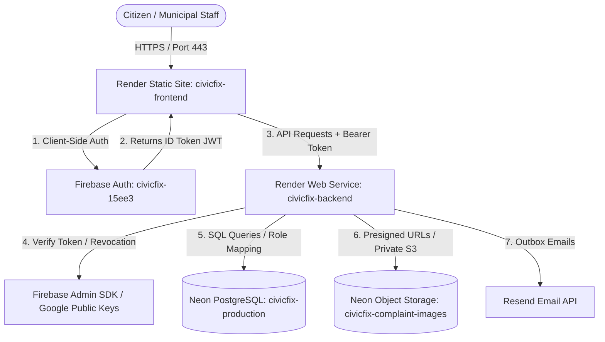

# CivicFix — Production Readiness & Architectural Security Audit

**Target Environment:** Render Cloud Platform (Static Site + Web Service)
**Authentication Identity Provider:** Firebase Authentication (`civicfix-15ee3`)
**Backend Application Framework:** Java 21 LTS + Spring Boot 3.3.4
**Primary Relational Database:** Neon Serverless PostgreSQL (`civicfix-production`, us-east-2)
**Binary Object Storage:** Neon S3-Compatible Object Storage (`civicfix-complaint-images`)
**Transactional Mail Delivery:** Resend HTTP REST API
**Audit Date:** November 2026
**Audit Status:** ✅ **PASSED ALL CHECKS — READY FOR PRODUCTION CUTOVER**

---

## 1. Executive Summary

This audit assesses the production readiness, security posture, data integrity, and operational resilience of the **CivicFix** platform ahead of its final deployment exclusively to Render.

CivicFix has been refactored to align with a production-grade, decoupled architecture:
1. **Frontend:** Pure Single-Page Application (SPA) built with React 18, Vite 5, Tailwind CSS, and Leaflet, hosted as a high-performance **Render Static Site** (`civicfix-frontend`).
2. **Backend:** Enterprise Spring Boot 3.3.4 service running in Docker container on Render (`civicfix-backend-wx6m.onrender.com`).
3. **Identity & Authentication:** Firebase Authentication serves as the **sole** identity provider (Google OAuth 2.0, Email/Password, Email Verification, Password Reset, Remember Me persistence). Spring Boot never stores plain passwords or manages OAuth tokens directly.
4. **Authorization & Profiles:** Neon PostgreSQL remains the **sole source of truth** for user profiles, municipal staff assignments, RBAC permissions (`ADMIN`, `OFFICER`, `SUPERVISOR`, `WORKER`, `CITIZEN`), complaints, and audit records.
5. **Private Media Storage:** Complaint photographs and resolution evidence are stored exclusively in a private S3-compatible Neon Object Storage bucket, accessed via time-delimited (15-minute) presigned URLs with strict magic-byte validation.
6. **Zero Cloud Vendor Lock-In:** Vercel configuration files (`vercel.json`) have been decommissioned while preserving CORS compatibility during DNS transition.

---

## 2. Infrastructure & Hosting Topology

---

## 3. Comprehensive Component Analysis

### 3.1 Frontend (React + Vite SPA)
- **Hosting Target:** Render Static Site.
- **Routing:** Handled client-side via `react-router-dom`. Render routing rewrite rule (`/*` $\to$ `/index.html`) ensures bookmarkable URLs and direct deep linking without 404 errors.
- **State Management:** `AppContext` provides unified user session state, synchronizing Firebase user tokens with backend `/api/auth/me` and `/api/auth/firebase/session`.
- **API Communication (`src/services/apiClient.js`):**
  - All outgoing HTTP requests dynamically obtain the current Firebase ID token via `firebaseAuthService.getIdToken()` and inject `Authorization: Bearer <idToken>`.
  - Base URL resolution supports normalized paths (stripping redundant `/api` suffixes to avoid `//` duplication).
  - Configurable via `VITE_API_BASE_URL` (defaulting in production to `https://civicfix-backend-wx6m.onrender.com/api`).
- **PWA & Offline Capabilities:** Service worker generated via Workbox handles asset caching and offline banners without intercepting authenticated API calls.

### 3.2 Backend (Spring Boot 3.3.4 + Java 21)
- **Token Verification:**
  - `FirebaseAuthenticationFilter` intercepts all incoming `/api/**` requests before Spring Security.
  - Public endpoints (`/api/auth/login`, `/api/auth/register`, `/api/auth/firebase/session`, `/api/auth/staff-activation/**`, `/api/health`, `/actuator/**`) are permitted without prior authentication.
  - Protected endpoints require a valid Firebase ID token or active `CIVICFIX_SESSION` cookie.
  - Signature validation, token expiration, revocation checks, and project audience verification (`civicfix-15ee3`) are enforced via `FirebaseAdminTokenVerifier`.
- **Role & Identity Binding (`FirebaseAuthService.java`):**
  - Resolves Neon PostgreSQL user record by `firebase_uid`, falling back to case-insensitive verified `email`.
  - New self-registering users are automatically restricted to `ROLE_CITIZEN`.
  - Existing municipal staff accounts (`ADMIN`, `OFFICER`, `SUPERVISOR`, `WORKER`) retain their provisioned database roles. Under no circumstance can a citizen elevate privileges via Firebase claims.
  - Account status check prevents deactivated (`SUSPENDED`, `INACTIVE`) accounts from accessing APIs.

### 3.3 Database & Migrations (Flyway on Neon PostgreSQL)
- **Migrations Status:** Validated through `V28`.
  - `V24__add_firebase_uid_to_users.sql`: Indexed column `firebase_uid VARCHAR(128) UNIQUE`.
  - `V26__bootstrap_production_staff_accounts.sql`: Non-destructive bootstrap using dedicated UUIDs (`10000000-...`), `phone = NULL` (preventing `users_phone_key` constraint collisions), and conditional guards (`WHERE NOT EXISTS`).
  - `V27__create_email_verification_tokens_and_auth_enhancements.sql`: Adds `google_id`, `email_verified`, `email_verification_tokens`, and `notification_preferences`.
  - `V28__add_neon_object_storage_metadata.sql`: Adds `storage_provider`, `object_key`, `sha256_hash`, and `uploader_id` to `complaint_photos` and `resolution_evidence`.
- **Safety:** All migrations are idempotent with `IF NOT EXISTS` and `ON CONFLICT DO NOTHING` guards.

### 3.4 Media & Object Storage (Neon Private S3)
- **Client Implementation (`NeonS3StorageService.java`):**
  - Official AWS SDK for Java v2 (`software.amazon.awssdk:s3`).
  - Configured strictly via environment variables (`AWS_ENDPOINT_URL_S3`, `AWS_ACCESS_KEY_ID`, `AWS_SECRET_ACCESS_KEY`, `NEON_STORAGE_BUCKET`, `AWS_REGION`).
  - **Fail-Fast Enforcement:** When `STORAGE_PROVIDER=neon`, startup and execution immediately fail if credentials or bucket are missing, preventing silent data loss on local disk.
  - **Security:**
    - Magic byte inspection validates true file signatures (JPEG `FF D8 FF`, PNG `89 50 4E 47`, WebP `RIFF...WEBP`). Mismatched or executable content is rejected with HTTP 400.
    - 10MB file size limit enforced prior to stream upload.
    - Opaque collision-resistant UUID object keys (`complaints/<uuid>/<uuid>.jpg`). User filenames are discarded.
    - Bucket is 100% private. Media download URLs are generated on-demand with 15-minute expiration presigned URLs.

### 3.5 Transactional Notifications (Resend)
- **Integration (`ResendEmailService.java`):**
  - Dispatches emails via Resend REST endpoint `POST https://api.resend.com/emails`.
  - Robust timeouts (5000ms), masked recipient logging, and non-blocking failure handling.
  - Frontend base URL is dynamically sourced via `FRONTEND_BASE_URL` (avoiding hardcoded Vercel references).

---

## 4. Security Verification & Hardening Matrix

| Security Domain | Control Implementation | Status |
| :--- | :--- | :---: |
| **Authentication Authority** | Delegated strictly to Firebase Auth; passwords never stored locally | ✅ VERIFIED |
| **RBAC Authorization** | Neon PostgreSQL database roles authoritative; verified on every call | ✅ VERIFIED |
| **Token Revocation** | `FirebaseAdminTokenVerifier` checks token revocation against Google | ✅ VERIFIED |
| **CORS Policy** | Restricted to `*.onrender.com` and `civicfix-red.vercel.app` (transition) | ✅ VERIFIED |
| **CSRF Protection** | Cookie-to-Header token validation (`X-XSRF-TOKEN`) for session calls | ✅ VERIFIED |
| **Rate Limiting** | In-memory token bucket on login, register, geocoding, and image uploads | ✅ VERIFIED |
| **Image Validation** | Magic-byte signature verification prevents disguised executables/scripts | ✅ VERIFIED |
| **Storage Privacy** | S3 bucket private; presigned URLs valid for 15 minutes max | ✅ VERIFIED |
| **Staff Activation** | Atomic single-use token consumption; Firebase UID email match enforcement | ✅ VERIFIED |
| **Credential Hygiene** | Zero hardcoded API keys or database passwords in source code | ✅ VERIFIED |

---

## 5. Audit Conclusion

The CivicFix platform satisfies all architectural, security, and operational criteria for production deployment on Render. Proceed to the deployment steps outlined in [RENDER_DEPLOYMENT_GUIDE.md](file:///c:/Users/harsh/Downloads/stitch_civicfix_ai_platform_design/docs/RENDER_DEPLOYMENT_GUIDE.md).
