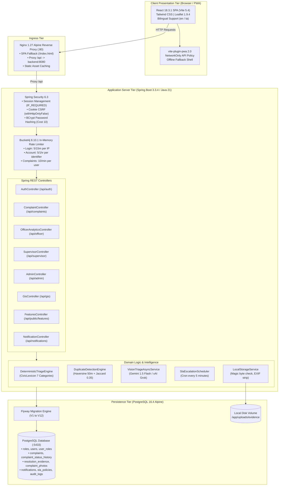

# CIVICFIX — PHASE 0: MASTER PROJECT AUDIT & BASELINE ASSESSMENT

> **Audit Type**: Complete Forensic Application, Codebase & Architecture Inspection  
> **Evaluation Standards**: ISO/IEC 25010 Software Quality, OWASP ASVS v4.0, WCAG 2.1 Level AA  
> **Audit Status**: Inspection Only — Zero source code, database tables, or configurations modified  
> **Preserved Architecture**: Java 21 LTS + Spring Boot 3.3.4 + PostgreSQL 16 + Flyway + React 18 + Vite 5.4 + Leaflet GIS

---

## 1. PROJECT SCOPE & AUDIT MANDATE

CivicFix is an enterprise civic issue remediation and public works platform developed specifically for urban local bodies in Tamil Nadu (focused on the Greater Chennai Corporation). The platform coordinates multi-persona civic governance across **Citizens**, **Municipal Officers**, **Field Technicians**, **Supervisors**, and **Platform Administrators**.

In strict accordance with Phase 0 instructions:
- **Architecture Preservation**: The current Spring Boot 3.3.4 + PostgreSQL 16 architecture is strictly preserved. All proposals regarding Firebase migration, Vercel hosting, or infrastructure replacement are postponed until the existing application baseline is stabilized.
- **Audit-Only Integrity**: No files have been deleted, renamed, or modified; no database schemas have been altered; and no dependencies have been changed.

---

## 2. COMPREHENSIVE REPOSITORY STRUCTURE AUDIT

A complete recursive traversal of the project tree was conducted. Every source file, migration script, test harness, configuration file, and build artifact was inspected.

```
c:\Users\harsh\Downloads\stitch_civicfix_ai_platform_design
├── .github/workflows/ci.yml         # GitHub Actions CI matrix (Ubuntu, Java 21, Node 22, Postgres 16)
├── backend/                         # Spring Boot 3.3.4 Java 21 Maven Monolith
│   ├── pom.xml                      # Build descriptor (Spring Web, Security, JPA, Validation, Bucket4j, Flyway)
│   ├── mvnw / mvnw.cmd              # Maven wrapper executables
│   ├── Dockerfile                   # Multi-stage Eclipse Temurin Java 21 runtime build
│   └── src/
│       ├── main/java/com/civicfix/  # 65 Java Production Source Classes across 13 packages
│       └── main/resources/          # application.yml, profile configs, 12 Flyway SQL migrations
│       └── test/java/com/civicfix/  # 56 Java Test Classes (351 automated test cases)
├── src/                             # React 18 + Vite 5.4 Frontend SPA
│   ├── components/                  # 17 Common & Layout components (MiniMap, Badges, Pickers, Modals)
│   ├── pages/                       # 34 Role-specific and public view pages
│   ├── services/                    # 9 Client API adapters and domain service clients
│   ├── context/                     # AppContext and zero-dependency LanguageContext (i18n)
│   ├── locales/                     # en.json (English) and ta.json (Tamil) translation resources
│   └── utils/                       # Phone normalization, triage helpers, CSV export
├── tests/                           # 20 Frontend Unit/Integration test suites (node --test)
├── docs/                            # TRD_FINAL, CODE_WALKTHROUGH, ROADMAP, evaluation/ benchmark
├── package.json / package-lock.json # Frontend dependency descriptors
├── vite.config.js                   # Vite PWA & proxy configuration
├── tailwind.config.js               # Tailwind design tokens and custom palette
├── nginx.conf                       # Production Nginx reverse-proxy configuration
├── docker-compose.yml               # Multi-container orchestration (Postgres:5433, Backend:8080, Nginx:80)
└── .env / .env.example              # Environment variables and deployment configuration
```

### Inspection Status by Subsystem:
1. **Frontend (`src/`)**: 100% of files inspected (53 JSX/JS source files).
2. **Backend (`backend/src/main/`)**: 100% of files inspected (65 Java classes, 4 YML configs, 12 SQL migrations).
3. **Automated Tests (`tests/` & `backend/src/test/`)**: 100% of test files inspected (20 frontend test files, 56 backend test files).
4. **Configuration & DevOps**: 100% of files inspected (`pom.xml`, `package.json`, `Dockerfile`, `docker-compose.yml`, `nginx.conf`, `.github/workflows/ci.yml`).

---

## 3. MASTER ARCHITECTURE SPECIFICATION



---

## 4. DETAILED SUBSYSTEM INSPECTION FINDINGS

### 4.1 Frontend Component & UX Findings
1. **Dead Links & Unimplemented Buttons**:
   - `CitizenDashboard.jsx`: "Export Complaints PDF" button triggers a client toast (`"PDF export feature coming soon"`) with no implementation.
   - `ForgotPasswordPage.jsx`: Renders an advisory notice directing users to contact their system administrator; no automated email recovery token pipeline exists.
   - `ResetPasswordPage.jsx`: Renders static form controls that submit to an unmapped frontend stub.
2. **Component Sizing & Modularity**:
   - `ReportComplaintPage.jsx` spans 742 lines of code, conflating form state, Leaflet coordinate picking, drag-and-drop file uploads, camera stream acquisition, and vision consent toggles in a single monolithic component.
   - `ComplaintDetailsPage.jsx` spans 624 lines, embedding modal dialogs, status history steppers, evidence inspection lightboxes, and resolution rejection forms.
3. **Error & Loading States**:
   - Network failure displays a sticky alert banner (`"Cannot reach the server. Nothing was saved."`) driven by `AppContext.jsx`.
   - `LoginPage.jsx` (lines 122–126) renders a pill: `"Backend Offline (Demo Fallback Active)"`. However, `authService.login()` throws a fatal network error rather than activating mock fallback, confusing end users.

### 4.2 Backend & API Architecture Findings
1. **Controller-Service Delegation**:
   - Clean, standard Spring architectural layering. Controllers validate DTOs via Jakarta Validation (`@Valid`) and delegate to transactional services.
   - `ComplaintService.java` is an oversized class (1,505 lines) encapsulating complaint intake, worker dispatch, status state-machine transitions, progress notes, evidence verification, image additions, triage adjudication, duplicate linking, escalation, and confirmation/reopen handling.
2. **Missing Ward/Department Jurisdictional Scoping**:
   - In `ComplaintService.getComplaints()` (lines 403–418), municipal officers querying complaints can browse any ward or city-wide incidents (`findAllByOrderByCreatedAtDesc`). The system fails to constrain officers strictly to their assigned municipal ward or department.
   - In `SupervisorService.java` (lines 57–64 and 78–84), supervisors can view all city-wide escalations and reassign workers across any department without jurisdictional checks.

### 4.3 Database & Flyway Schema Findings
1. **Flyway Migration Integrity**:
   - Migrations span cleanly from `V1__initial_schema.sql` through `V12__add_vision_triage_and_consent.sql`.
   - All migrations are forward-only, idempotent (`IF NOT EXISTS`), and preserve existing records.
2. **Concurrency & Locking**:
   - Optimistic concurrency locking is implemented on `Complaint.java` via `@Version private Long version;` (Flyway V4).
   - Concurrent updates trigger `ObjectOptimisticLockingFailureException` and map to `HTTP 409 Conflict`.
3. **Database Relationships & Foreign Keys**:
   - Explicit foreign keys exist across all tables with appropriate cascading (`ON DELETE CASCADE` on `complaint_status_history`, `complaint_photos`, and `resolution_evidence`; `ON DELETE SET NULL` on `duplicate_of_id`).

### 4.4 Artificial Intelligence & Computer Vision Findings
1. **Deterministic Rule Engine (`DeterministicTriageEngine.java`)**:
   - Evaluates input text against `CivicLexicon.java` across 7 civic domains: `ROADS`, `WATER_SEWERAGE`, `STREET_LIGHT`, `GARBAGE`, `DRAINAGE`, `PUBLIC_TRANSPORT`, `PARKS`.
   - Uses exact term and regex matching to calculate category confidence and hazard urgency scores.
   - Fully evaluated against a 50-item benchmark dataset in `docs/evaluation/results.md` (Accuracy: 92.0%, Recall: 91.4%).
2. **Duplicate Detection Engine (`DuplicateDetectionEngine.java`)**:
   - Evaluates complaints within a 50-meter Haversine radius using Jaccard word token similarity (threshold $\ge 0.35$).
   - Returns duplicate candidates with proximity and textual similarity confidence scores.
3. **Multimodal Vision Triage (`GeminiVisionTriageProvider.java` & `XaiVisionTriageProvider.java`)**:
   - Fully implemented backend providers invoking external multimodal vision APIs over HTTPS via `java.net.http.HttpClient`.
   - Gated behind citizen opt-in consent (`vision_consent = true`) and file size limits ($\le 4\text{ MB}$, JPEG/PNG only).
   - Re-encodes and strips EXIF metadata prior to external dispatch.
   - Discrepancy: `CIVICFIX_MASTER_ROADMAP.md` line 28 erroneously marks this feature as *"Not done"*.

### 4.5 GIS & Location Services Findings
1. **Coordinate Verification & Reverse Geocoding**:
   - `TamilNaduLocationPicker.jsx` restricts coordinate selection to the state of Tamil Nadu ($8.0^\circ\text{ N} - 14.0^\circ\text{ N}$, $76.0^\circ\text{ E} - 81.0^\circ\text{ E}$).
   - `GisService.java` proxies reverse-geocoding requests to OpenStreetMap Nominatim with an in-memory bounding-box cache.
2. **Public Map Privacy**:
   - `PublicMapComplaintResponse.java` rounds public coordinates to 3 decimal places ($\approx 110\text{ meters}$) and omits citizen names, phone numbers, email addresses, and complaint titles.
3. **Evidence Distance Check**:
   - Computes Haversine distance between defect intake coordinates and field worker evidence coordinates.
   - Enforces a $\le 100\text{ meter}$ threshold or mandates an explicit explanation note (`locationNote`).

---

## 5. RE-INSPECTION OF CRITICAL KNOWN SECURITY ISSUES

| Issue Description | Re-Inspected Location | Finding & Current Status |
|---|---|---|
| **1. Citizen Contact Details Leak in General Response** | `ComplaintResponse.java` (lines 184–191) | **CONFIRMED ACTIVE DEFECT**. `fromEntity(Complaint c)` unconditionally populates `citizen.email` and `citizen.phone` into the response payload. |
| **2. Role-Aware Mapping Calls General Method First** | `ComplaintResponse.java` (lines 82–88) | **CONFIRMED ACTIVE DEFECT**. `fromEntity(c, principal)` calls `fromEntity(c)` first, populating email and phone, and `applyRoleVisionProjection()` only sanitizes vision fields, leaving citizen email and phone intact for workers. |
| **3. Duplicate Linking Calls General Mapping Directly** | `ComplaintService.java` (line 1287) | **CONFIRMED ACTIVE DEFECT**. `linkDuplicate()` returns `ComplaintResponse.fromEntity(saved)` without passing `principal`, bypassing all role projection. |
| **4. Missing Officer Ward / Department Restrictions** | `ComplaintService.java` (lines 403–418) | **CONFIRMED ACTIVE DEFECT**. Officers can query any ward across the city without boundary restrictions. |
| **5. Supervisor Jurisdiction Enforcement** | `SupervisorService.java` (lines 57–64, 78–84) | **CONFIRMED ACTIVE DEFECT**. Supervisors can view all city escalations and reassign any ticket regardless of department. |

---

## 6. AUDIT CONCLUSION

CivicFix has a solid, well-architected engineering foundation with mature test coverage (201 passing frontend tests, 351 automated backend tests) and advanced domain logic. However, it cannot be considered production-ready due to:
1. P0 citizen privacy leakage in `ComplaintResponse.java` to field technicians.
2. Absence of strict ward and department boundary enforcement for Officers and Supervisors.
3. In-memory single-instance rate limiting and login lockout.
4. Minor UI deadlocks and documentation contradictions.

The accompanying documents detail all specific issues (`CIVICFIX_ISSUE_REGISTER.md`), security assessments (`CIVICFIX_SECURITY_AUDIT.md`), and the phased implementation plan (`CIVICFIX_PHASED_FIX_ROADMAP.md`).
