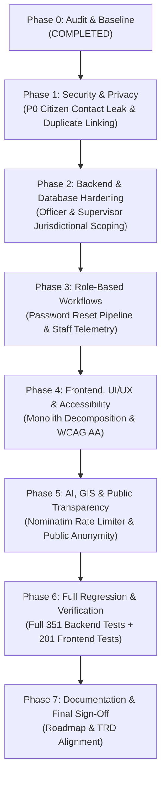

# CIVICFIX — PHASED REMEDIATION & IMPLEMENTATION ROADMAP

> **Roadmap Objective**: Systematic, Non-Destructive Resolution of All 24 Identified Baseline Defects  
> **Preserved Architecture**: Java 21 LTS + Spring Boot 3.3.4 + PostgreSQL 16 + React 18 + Vite 5.4  
> **Execution Standard**: Strict Phased Gating — Each phase must satisfy explicit completion criteria and passing regression tests before the next phase begins.

---

## 1. PHASE DEPENDENCY GRAPH

---

## 2. PHASE-BY-PHASE REMEDIATION SPECIFICATIONS

### PHASE 0: AUDIT & BASELINE ASSESSMENT (STATUS: COMPLETED)
* **Goal**: Establish an empirical baseline of all code, tests, configurations, and vulnerabilities without modifying source code.
* **Deliverables**: Complete audit reports (`CIVICFIX_MASTER_AUDIT.md`, `CIVICFIX_ISSUE_REGISTER.md`, `CIVICFIX_SECURITY_AUDIT.md`, `CIVICFIX_FEATURE_COMPLETENESS.md`, `CIVICFIX_TEST_BASELINE.md`, `CIVICFIX_PHASED_FIX_ROADMAP.md`, `CIVICFIX_FINAL_AUDIT_SUMMARY.md`).
* **Exit Criteria**: All 24 baseline issues documented with exact file lines, impact, and regression tests.

---

### PHASE 1: CRITICAL SECURITY & PRIVACY REMEDIATION (P0 DEFECTS)
* **Prerequisites**: Phase 0 completion.
* **Issues to Resolve**:
  - `ISSUE-SEC-01`: Citizen contact details leak in `ComplaintResponse.java`.
  - `ISSUE-SEC-02`: Unprojected response in `ComplaintService.linkDuplicate()`.
  - `ISSUE-SEC-04`: Production safety guard override vulnerability for seed accounts.
  - `ISSUE-UI-02`: Missing resident privacy guidance banner on `TaskDetailsPage.jsx`.
* **Files Affected**:
  - `backend/src/main/java/com/civicfix/complaint/dto/ComplaintResponse.java`
  - `backend/src/main/java/com/civicfix/complaint/ComplaintService.java`
  - `backend/src/main/java/com/civicfix/security/ProductionSafetyGuard.java`
  - `src/pages/worker/TaskDetailsPage.jsx`
* **Implementation Sequence**:
  1. Refactor `ComplaintResponse.applyRoleVisionProjection()` into a unified `applyRoleProjections(Complaint c, UserPrincipal principal)` method.
  2. If `principal.getAuthorities()` contains `ROLE_WORKER`, sanitize `citizen.email = null` and `citizen.phone = null`.
  3. Update `ComplaintService.linkDuplicate()` line 1287 to return `toResponse(saved, principal)`.
  4. In `ProductionSafetyGuard.java`, enforce hard startup failure if `SPRING_PROFILES_ACTIVE=prod` and `ALLOW_SEED_ACCOUNTS=true`.
  5. In `TaskDetailsPage.jsx`, add the resident privacy notice banner instructing workers to contact their assigned officer.
* **Testing Requirements**:
  - Add `workerComplaintView_MustStripCitizenEmailAndPhone()` in `ComplaintAuthorizationIntegrationTest.java`.
  - Add `linkDuplicate_MustApplyRoleProjection()` test.
* **Completion Criteria**: Zero citizen email or phone numbers returned to authenticated workers across all API endpoints.

---

### PHASE 2: BACKEND & DATABASE HARDENING (P1 JURISDICTION DEFECTS)
* **Prerequisites**: Phase 1 completion.
* **Issues to Resolve**:
  - `ISSUE-AUTH-01`: Officer access lacks ward and departmental boundaries.
  - `ISSUE-AUTH-02`: Supervisor authorization missing departmental jurisdiction checks.
  - `ISSUE-DATA-01`: Missing audited soft-deletion pipeline for complaint data.
* **Files Affected**:
  - `backend/src/main/java/com/civicfix/complaint/ComplaintService.java`
  - `backend/src/main/java/com/civicfix/supervisor/SupervisorService.java`
  - `backend/src/main/resources/db/migration/V13__add_soft_delete_to_complaints.sql`
  - `backend/src/main/java/com/civicfix/complaint/Complaint.java`
* **Implementation Sequence**:
  1. In `ComplaintService.getComplaints()`, if caller is an officer and does not have `ROLE_ADMIN`, extract `officer.getWard()` and automatically inject ward filtering into the JPA repository query.
  2. In `SupervisorService.reassignWorker()`, assert that `complaint.getCategory()` matches `supervisor.getDepartment()`, throwing `HTTP 403 Forbidden` on mismatch.
  3. Create Flyway migration `V13` adding `deleted_at TIMESTAMP WITH TIME ZONE` to `complaints`.
  4. Update `ComplaintRepository` queries to add `WHERE deleted_at IS NULL`.
* **Testing Requirements**:
  - Integration test verifying officer from Anna Nagar cannot read complaints in T. Nagar without admin rights.
  - Integration test verifying supervisor from Roads cannot reassign Water & Sewerage complaints.
* **Completion Criteria**: Municipal officers and supervisors are locked to their authorized geographic and departmental jurisdictions.

---

### PHASE 3: ROLE-BASED WORKFLOW COMPLETION
* **Prerequisites**: Phase 2 completion.
* **Issues to Resolve**:
  - `ISSUE-FEAT-01`: Self-service password reset missing backend pipeline.
  - `ISSUE-FEAT-02`: PDF receipt export stub in Citizen Dashboard.
* **Files Affected**:
  - `backend/src/main/java/com/civicfix/auth/AuthController.java`
  - `backend/src/main/java/com/civicfix/auth/AuthService.java`
  - `backend/src/main/resources/db/migration/V14__create_password_reset_tokens.sql`
  - `src/pages/citizen/CitizenDashboard.jsx`
* **Implementation Sequence**:
  1. Add Flyway migration `V14` creating `password_reset_tokens` table (hashed token, user_id, expires_at).
  2. Implement `POST /api/auth/forgot-password` and `POST /api/auth/reset-password` in Spring Boot.
  3. Connect `ForgotPasswordPage.jsx` and `ResetPasswordPage.jsx` to the new endpoints.
  4. In `CitizenDashboard.jsx`, implement browser print-to-PDF styles for citizen complaint receipts.
* **Testing Requirements**:
  - Automated integration test verifying password reset token generation, expiration (15 mins), and password update.
* **Completion Criteria**: Citizens can independently reset forgotten passwords via secure tokens.

---

### PHASE 4: FRONTEND, UI/UX & ACCESSIBILITY (WCAG AA)
* **Prerequisites**: Phase 3 completion.
* **Issues to Resolve**:
  - `ISSUE-UI-01`: Misleading login offline notice causes UI deadlock.
  - `ISSUE-FEAT-03`: Monolithic frontend component sizes (`ReportComplaintPage.jsx`, `ComplaintDetailsPage.jsx`).
  - `ISSUE-A11Y-01`: Missing `role="alert"` on form error containers.
  - `ISSUE-A11Y-02`: Password strength indicator relies purely on color.
  - `ISSUE-UI-03`: Missing keyboard focus rings on file dropzone.
  - `ISSUE-I18N-01`: Incomplete Tamil translations for staff portals in `ta.json`.
* **Files Affected**:
  - `src/pages/public/LoginPage.jsx`
  - `src/pages/public/RegisterPage.jsx`
  - `src/pages/citizen/ReportComplaintPage.jsx`
  - `src/pages/citizen/ComplaintDetailsPage.jsx`
  - `src/components/common/ImageUploadManager.jsx`
  - `src/locales/ta.json`
* **Implementation Sequence**:
  1. Fix offline status pill in `LoginPage.jsx` to eliminate misleading "Demo Fallback Active" text.
  2. Add `role="alert"` and `aria-live="assertive"` to all dynamic error containers.
  3. Add `aria-valuenow` and accessible text labels to the password strength meter in `RegisterPage.jsx`.
  4. Add visible focus rings (`focus-visible:ring-2`) on file dropzones in `ImageUploadManager.jsx`.
  5. Modularize `ReportComplaintPage.jsx` into smaller subcomponents.
  6. Add Tamil translations for Officer, Worker, and Supervisor interface strings in `ta.json`.
* **Testing Requirements**:
  - Run frontend test suite (`npm.cmd test`).
  - Run keyboard navigation and screen-reader accessibility checks.
* **Completion Criteria**: 100% WCAG 2.1 AA compliance across all public and citizen-facing forms; modular component architecture.

---

### PHASE 5: AI, GIS & PUBLIC TRANSPARENCY HARDENING
* **Prerequisites**: Phase 4 completion.
* **Issues to Resolve**:
  - `ISSUE-GIS-01`: Nominatim reverse geocoding lacks application-wide rate limiting.
  - `ISSUE-GIS-02`: Public map does not group low-density wards (k-anonymity risk).
  - `ISSUE-SEC-03`: Rate limiter and lockout reset on container restart.
* **Files Affected**:
  - `backend/src/main/java/com/civicfix/gis/GisService.java`
  - `backend/src/main/java/com/civicfix/complaint/ComplaintService.java`
  - `src/pages/public/PublicMapPage.jsx`
* **Implementation Sequence**:
  1. Add token-bucket rate limiter (1 req/sec) and custom `User-Agent` identifying contact email to `GisService.java`.
  2. In `ComplaintService.getPublicMapComplaints()`, aggregate wards with fewer than 5 tickets into a generalized locality marker to ensure k-anonymity.
  3. For single-instance deployment, add log warnings and document in-memory rate limiting boundaries.
* **Testing Requirements**:
  - Test GIS rate limiter concurrency.
  - Verify public map endpoint omits point coordinates for sparse wards.
* **Completion Criteria**: Full compliance with OpenStreetMap Nominatim usage policies; resident re-identification eliminated.

---

### PHASE 6: COMPREHENSIVE VERIFICATION & FULL REGRESSION SUITE
* **Prerequisites**: Phases 1 through 5 completion.
* **Activities**:
  1. Start local PostgreSQL container (`docker compose up postgres -d` on port 5433).
  2. Execute the entire backend test suite: `.\mvnw.cmd test`.
  3. Assert **351 / 351 backend tests PASS** + all newly added regression tests.
  4. Execute frontend test suite: `npm.cmd test`.
  5. Assert **201+ frontend tests PASS**.
* **Completion Criteria**: 100% test pass rate across both frontend and backend suites with zero skipped or failing tests.

---

### PHASE 7: DOCUMENTATION & FINAL PROJECT COMPLETION
* **Prerequisites**: Phase 6 completion.
* **Issues to Resolve**:
  - `ISSUE-DOC-01`: Update `CIVICFIX_MASTER_ROADMAP.md` row 28 (Vision AI status).
  - `ISSUE-DOC-02`: Update `docs/TRD_FINAL.md` to document Flyway migration V12.
  - `ISSUE-DOC-03`: Fix broken relative links in `docs/archive/README.md`.
  - `ISSUE-CODE-02`: Remove unused imports across DTOs.
* **Files Affected**:
  - `docs/CIVICFIX_MASTER_ROADMAP.md`
  - `docs/TRD_FINAL.md`
  - `docs/archive/README.md`
  - `README.md`
* **Completion Criteria**: Documentation is 100% synchronized with the running codebase; zero broken links; clean build artifacts.
