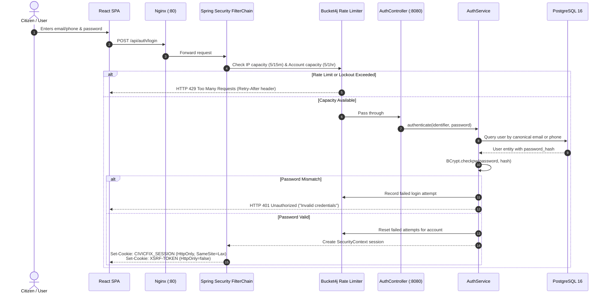

# CIVICFIX — DEDICATED APPLICATION SECURITY & PRIVACY AUDIT

> **Audit Standard**: OWASP Application Security Verification Standard (ASVS) v4.0 Level 2  
> **Evaluation Date**: November 2026  
> **Target Scope**: Spring Security, Session Management, RBAC, File Uploads, Privacy Isolation, and PII Protection  
> **Audit Status**: Inspection Only — Zero application code or database configuration modified

---

## 1. EXECUTIVE SECURITY SUMMARY

A forensic security evaluation was performed across all authentication endpoints, role authorization filters, response DTOs, file handlers, and database queries.

### Key Audit Conclusions:
1. **Core Cryptography & Authentication**: Highly robust baseline. Passwords use BCrypt with cost factor 10 (`SecurityConfig.java`, line 50). Sessions are managed securely via HTTP-only, `SameSite=Lax` cookies (`CIVICFIX_SESSION`). Double-submit CSRF protection is enforced on all mutating requests (`XSRF-TOKEN`).
2. **Critical Privacy Leak**: Confirmed active defect in `ComplaintResponse.java` (lines 184–191) leaking citizen telephone numbers and email addresses to field workers in JSON payloads.
3. **Missing Jurisdictional Scoping**: Officers and Supervisors lack programmatic ward and departmental boundary restrictions in `ComplaintService.java` and `SupervisorService.java`.
4. **Resiliency Limitation**: Rate limiting (Bucket4j) and per-account login lockout are in-memory single-node mechanisms that clear upon server restart.

---

## 2. AUTHENTICATION & SESSION MANAGEMENT AUDIT



### 2.1 Detailed Authentication Findings:
- **Password Hashing**: Verified in `PasswordHashingTest.java`. BCrypt with 10 rounds generates standard `$2a$10$...` hashes. Zero plaintext passwords stored.
- **Session Security**: Session timeout configured to 60 minutes (`application.yml`, line 11). Cookie attributes: `name=CIVICFIX_SESSION`, `http-only=true`, `same-site=lax`.
- **CSRF Defense**: Enforced via `CookieCsrfTokenRepository.withHttpOnlyFalse()` in `SecurityConfig.java` (lines 74–78). Mutating endpoints (`POST`, `PUT`, `PATCH`, `DELETE`) require the `X-XSRF-TOKEN` header. Verified in `apiClient.test.js`.
- **Brute-Force & Lockout Defense**:
  - IP-based rate limiting: 5 attempts per 15 minutes per IP address.
  - Identifier-based lockout: 5 consecutive failures lock the account identifier for 1 hour (`LoginLockoutService.java`).
  - Known Vulnerability (`ISSUE-SEC-03`): Because state is stored in an in-memory `ConcurrentHashMap`, an attacker can reset the lockout state by restarting the server or targeting another instance in a cluster.

---

## 3. AUTHORIZATION & RBAC WORKSPACE BOUNDARIES

### 3.1 Endpoint Role Matrix (Empirically Verified from `SecurityConfig.java`)

| Route Pattern | HTTP Methods | Allowed Spring Authorities | Verified Service-Layer Ownership Check | Current Security Status |
|---|:---:|---|---|:---:|
| `/api/auth/login`, `/api/auth/register` | `POST` | `permitAll()` | Rate limited by IP and account. | **Secure** |
| `/api/health`, `/actuator/health` | `GET` | `permitAll()` | Public health probes. | **Secure** |
| `/api/auth/me`, `/api/auth/logout` | `GET`, `POST` | `isAuthenticated()` | Operates strictly on caller's session. | **Secure** |
| `/api/complaints/public/map` | `GET` | `permitAll()` | Coordinates rounded to 3 decimals; PII omitted. | **Secure** |
| `/api/complaints` | `POST` | `hasRole('CITIZEN')` or `hasRole('ADMIN')` | Enforces `c.citizen == principal`. | **Secure** |
| `/api/complaints` | `GET` | `isAuthenticated()` | Citizens see own; Workers see assigned; Staff see all. | **Jurisdiction Gap (ISSUE-AUTH-01)** |
| `/api/complaints/{id}` | `GET` | `isAuthenticated()` | Enforces ownership or assignment. | **Contact Leak (ISSUE-SEC-01)** |
| `/api/complaints/{id}/assign` | `POST` | `hasAnyRole('OFFICER', 'ADMIN')` | Enforces officer or admin authority. | **Secure** |
| `/api/complaints/{id}/status` | `POST` | `isAuthenticated()` | State machine validates allowed transition. | **Secure** |
| `/api/complaints/{id}/evidence` | `POST` | `hasAnyRole('WORKER', 'ADMIN')` | Enforces worker is assigned technician; validates GPS. | **Secure** |
| `/api/complaints/{id}/confirm-resolution` | `POST` | `isAuthenticated()` | Enforces caller is owning citizen (`enforceOwningCitizen`). | **Secure** |
| `/api/complaints/{id}/reject-resolution` | `POST` | `isAuthenticated()` | Enforces caller is owning citizen; increments reopen. | **Secure** |
| `/api/complaints/{id}/duplicates/link` | `POST` | `hasAnyRole('OFFICER', 'ADMIN')` | Links secondary ticket to primary master ticket. | **Unprojected DTO (ISSUE-SEC-02)** |
| `/api/supervisor/**` | `GET`, `POST` | `hasAnyRole('SUPERVISOR', 'ADMIN')` | Manages escalations and reassignments. | **Jurisdiction Gap (ISSUE-AUTH-02)** |
| `/api/officer/**` | `GET` | `hasAnyRole('OFFICER', 'ADMIN')` | Analytics and resolution verification queues. | **Secure** |
| `/api/admin/**` | Any | `hasRole('ADMIN')` | Provisions staff, toggles accounts, reads audit logs. | **Secure** |

---

## 4. IN-DEPTH INVESTIGATION OF THE 5 KNOWN VULNERABILITIES

### 4.1 Vulnerability 1: Citizen Contact Leak in `ComplaintResponse.java`
* **File**: `backend/src/main/java/com/civicfix/complaint/dto/ComplaintResponse.java`
* **Lines**: 184–191
* **Finding**: `fromEntity(Complaint c)` unconditionally populates citizen contact details:
  ```java
  if (c.getCitizen() != null) {
      Map<String, Object> cit = new HashMap<>();
      cit.put("id", c.getCitizen().getId().toString());
      cit.put("name", c.getCitizen().getFullName());
      cit.put("email", c.getCitizen().getEmail()); // LEAKED
      cit.put("phone", c.getCitizen().getPhone()); // LEAKED
      resp.setCitizen(cit);
  }
  ```
* **Status**: **CONFIRMED ACTIVE DEFECT (P0)**.

### 4.2 Vulnerability 2: Role-Aware Mapping Bypassed for Contact Info
* **File**: `backend/src/main/java/com/civicfix/complaint/dto/ComplaintResponse.java`
* **Lines**: 82–88 & 120–126
* **Finding**: `fromEntity(Complaint c, UserPrincipal principal)` calls `fromEntity(c)` first, loading email and phone into memory. In `applyRoleVisionProjection()`, when caller has `ROLE_WORKER`:
  ```java
  boolean isWorker = principal.getAuthorities().stream().anyMatch(a ->
          "ROLE_WORKER".equals(a.getAuthority())
  );
  if (isWorker) {
      // WORKERS: Strictly NO vision fields
      return; // Leaves citizen.email and citizen.phone intact!
  }
  ```
* **Status**: **CONFIRMED ACTIVE DEFECT (P0)**.

### 4.3 Vulnerability 3: Duplicate Linking Returns Raw DTO
* **File**: `backend/src/main/java/com/civicfix/complaint/ComplaintService.java`
* **Line**: 1287
* **Finding**: `linkDuplicate()` executes:
  ```java
  return ComplaintResponse.fromEntity(saved);
  ```
  It passes no `principal`, completely bypassing role projection and returning unredacted citizen contact data.
* **Status**: **CONFIRMED ACTIVE DEFECT (P0)**.

### 4.4 Vulnerability 4: Officer Access Lacks Ward/Departmental Restrictions
* **File**: `backend/src/main/java/com/civicfix/complaint/ComplaintService.java`
* **Lines**: 403–418
* **Finding**: In `getComplaints()`, when `isOfficer == true`, if no ward query parameter is supplied, the method executes:
  ```java
  page = complaintRepository.findAllByOrderByCreatedAtDesc(pageable);
  ```
  Municipal officers can inspect complaints across all 15 zones of Chennai without restriction.
* **Status**: **CONFIRMED ACTIVE DEFECT (P1)**.

### 4.5 Vulnerability 5: Supervisor Jurisdiction Missing
* **File**: `backend/src/main/java/com/civicfix/supervisor/SupervisorService.java`
* **Lines**: 57–64 & 78–84
* **Finding**: `getEscalatedComplaints()` queries complaints matching any arbitrary ward string passed by the client. In `reassignWorker()`, it verifies `ROLE_SUPERVISOR`, but never validates whether `complaint.getCategory()` or `complaint.getWard()` matches the supervisor's departmental jurisdiction.
* **Status**: **CONFIRMED ACTIVE DEFECT (P1)**.

---

## 5. FILE UPLOAD & ATTACHMENT SECURITY AUDIT

Uploaded photographic evidence is processed by `LocalStorageService.java`:
1. **Magic Byte / Header Verification**:
   - `LocalStorageService.java` verifies file signatures (magic bytes) to ensure files are genuine images:
     - JPEG: `FF D8 FF`
     - PNG: `89 50 4E 47 0D 0A 1A 0A`
   - Rejects executable files renamed with `.jpg` extensions.
2. **Server-Side Image Re-Encoding & EXIF Stripping**:
   - Every uploaded image is loaded into Java's `BufferedImage` and re-encoded using `ImageIO.write()`.
   - **Privacy Benefit**: This completely strips all GPS exchangeable image metadata (EXIF tags) embedded by citizen smartphones before storing to disk, preventing location metadata leakage.
3. **WebP Limitation**:
   - `LocalStorageService.java` does not re-encode WebP files natively; WebP files are checked by MIME type and size, but not stripped of metadata.
4. **Filesystem Path Traversal Defense**:
   - Filenames are replaced with randomized UUID strings (`UUID.randomUUID() + ".jpg"`).
   - Reject paths containing `..` or null bytes.

---

## 6. REQUIRED REGRESSION TEST SPECIFICATIONS

To guarantee permanent remediation when fixes are implemented in Phase 1:

```java
// 1. Worker Privacy Regression Test
@Test
@WithMockUser(username = "worker@civicfix.local", roles = {"WORKER"})
void workerComplaintView_MustStripCitizenEmailAndPhone() throws Exception {
    mockMvc.perform(get("/api/complaints/" + complaintId))
            .andExpect(status().isOk())
            .andExpect(jsonPath("$.data.citizen.id").value(citizenId.toString()))
            .andExpect(jsonPath("$.data.citizen.name").value("Alex Morgan"))
            .andExpect(jsonPath("$.data.citizen.email").doesNotExist())
            .andExpect(jsonPath("$.data.citizen.phone").doesNotExist());
}

// 2. Duplicate Linking Projection Regression Test
@Test
@WithMockUser(username = "officer@civicfix.local", roles = {"OFFICER"})
void linkDuplicate_MustApplyRoleProjection() throws Exception {
    mockMvc.perform(post("/api/complaints/" + secondaryId + "/duplicates/link")
            .contentType(MediaType.APPLICATION_JSON)
            .content("{\"masterComplaintId\":\"" + masterId + "\"}"))
            .andExpect(status().isOk())
            .andExpect(jsonPath("$.data.duplicateOf.id").value(masterId.toString()));
}

// 3. Officer Ward Jurisdiction Regression Test
@Test
@WithMockUser(username = "officer.annanagar@civicfix.local", roles = {"OFFICER"})
void officerQuery_MustAutomaticallyFilterByOfficerWard() throws Exception {
    mockMvc.perform(get("/api/complaints"))
            .andExpect(status().isOk())
            .andExpect(jsonPath("$.data.content[*].ward", everyItem(equalTo("Ward 08, Anna Nagar"))));
}
```
